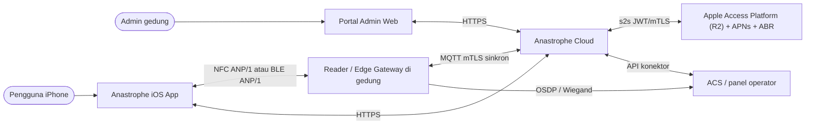
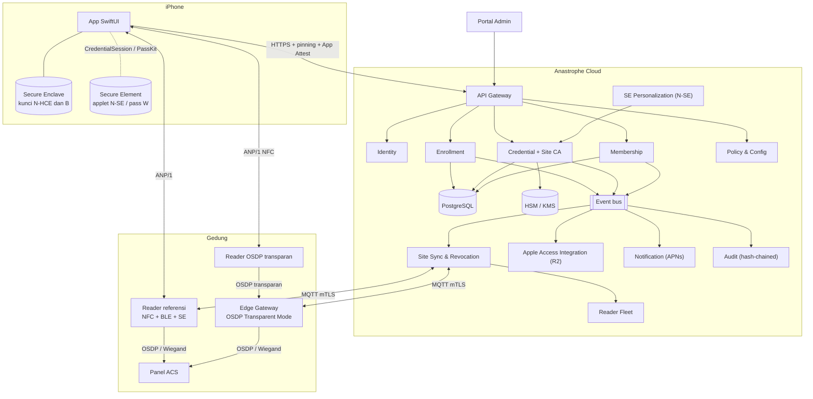
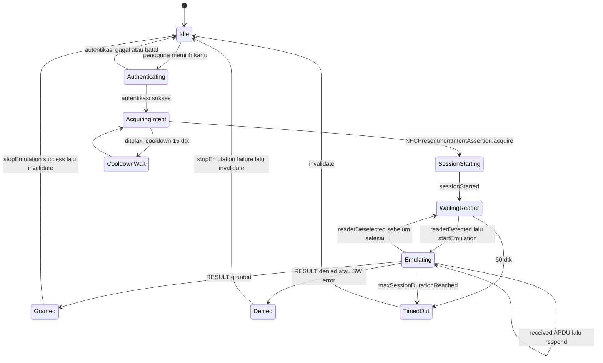
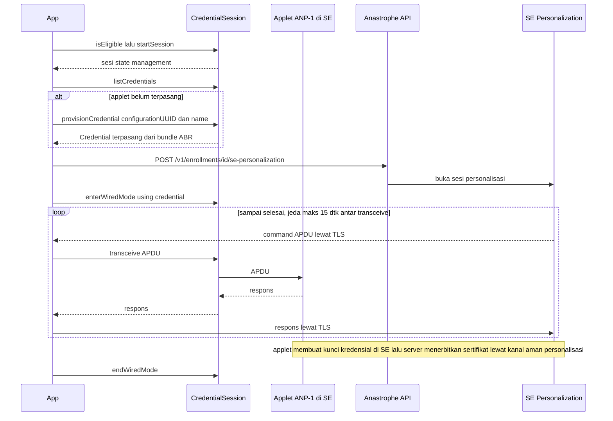
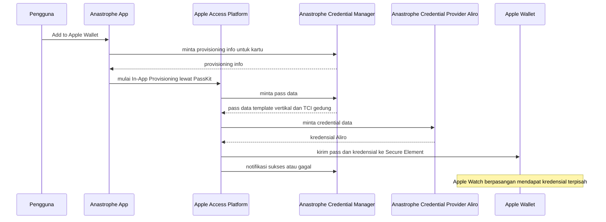
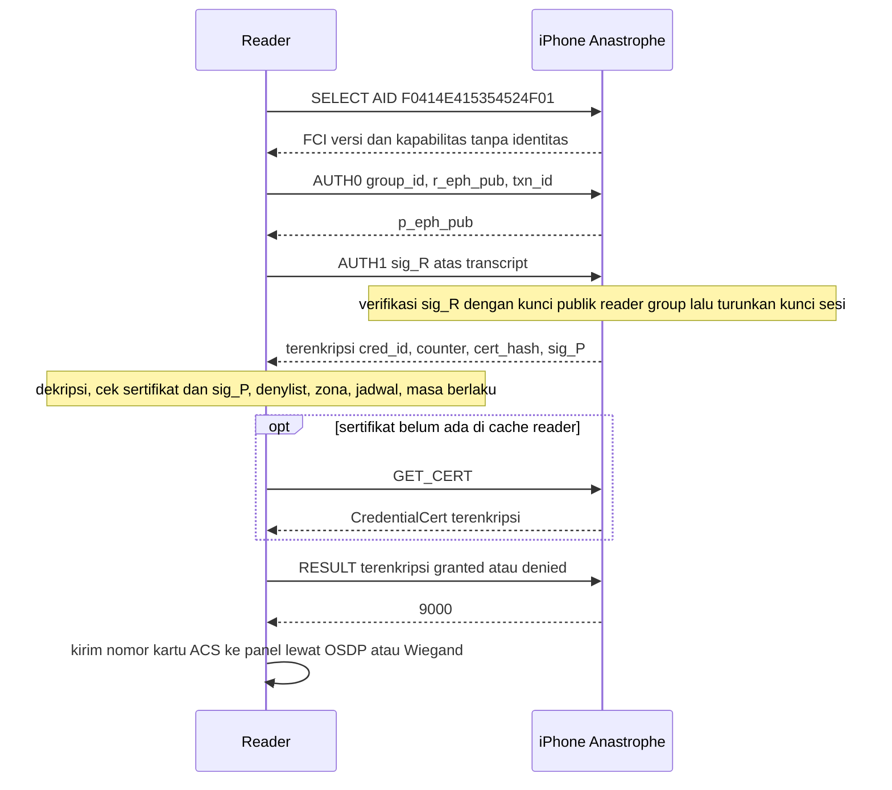
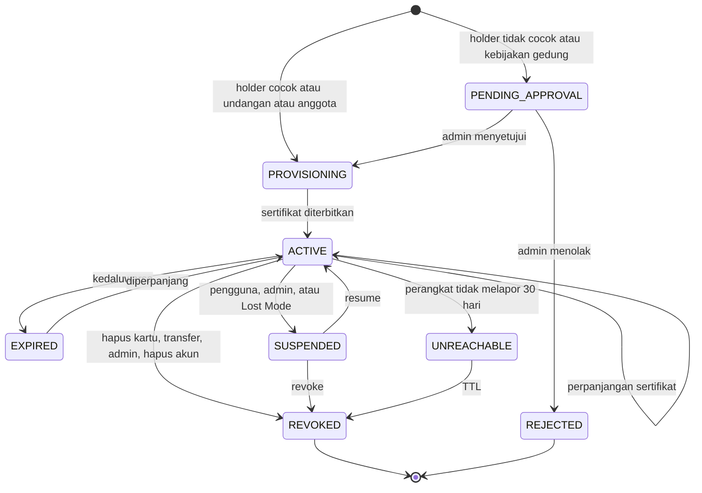
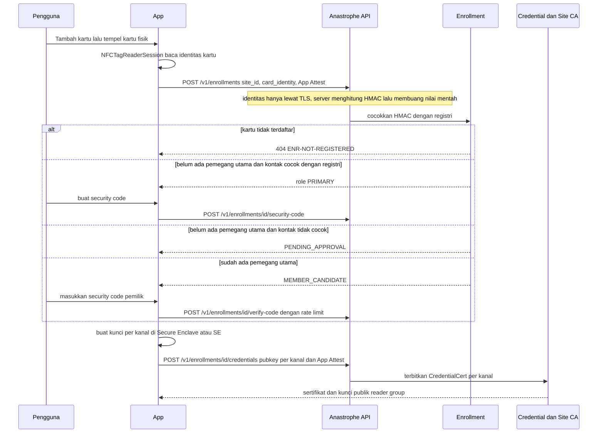

# SDD — Anastrophe: Software Design Document

| Item | Nilai |
|---|---|
| Versi dokumen | 2.0 (Draft untuk review) |
| Tanggal | 2026-11-01 |
| Status | Draft — 2 keputusan menunggu manusia: ADR-0017 (entitas hukum), ADR-0022 (reader uji BLE) |
| Dokumen terkait | [PRD](PRD.md) · [QA Suite](QA_SUITE.md) · [Research Evidence](research/RESEARCH_EVIDENCE.md) · [ADR](adr/README.md) · [Glosarium](../GLOSSARY.md) · [Design system iOS](design-system/anastrophe/pages/ios-app.md) |
| Lapisan keputusan | JEV (`jev_decide`) — ADR-0018 |

### Riwayat versi

| Versi | Tanggal | Ringkasan perubahan |
|---|---|---|
| 1.0 | 2026-11-01 | Draft awal: satu jalur NFC in-app, protokol challenge–response sederhana. |
| 2.0 | 2026-11-01 | Abstraksi tiga kanal (W/N/B); desain `CredentialSession` (personalisasi wired) dan BLE; **ANP/1 didesain ulang** (ECDH ephemeral, reader group diautentikasi lebih dulu, identitas terenkripsi, semua APDU < 255 B). Backend: kartu ↔ kredensial per kanal, perpanjangan sertifikat 7 hari, sengketa klaim, hapus akun. Reader referensi + gateway OSDP Transparent Mode. Keamanan, privasi, infrastruktur, observabilitas, katalog error. ADR dipindah ke `docs/adr/` dan diputuskan lewat JEV. |
| 2.1 | 2026-11-01 | ANP/1: format plaintext AUTH1/GET_CERT/RESULT, `cert_hash`, AAD respons, dan seq per pesan dipatok (§7.4, §7.6); penyamaan kerja verifikasi pada jalur `6982`; test vector v1 (§7.11). |
| 2.2 | 2026-11-01 | Perpanjangan sertifikat (ADR-0023): pemicu hanya setelah autentikasi tap (§5.5), challenge + format bukti kepemilikan (§8.4.2), endpoint (§8.5), kode `CRED-*` (§15). |
| 2.3 | 2026-11-01 | Audit log berantai hash per gedung (ADR-0024): kolom `chain`/`site_id`/`seq`, append-only, rumus hash (§8.1). |
| 2.4 | 2026-11-01 | Audit: tag hash `ANP1-AUDIT-v1`, data = teks `jsonb`, CHECK chain kanonik, batas deteksi dan head per jam (§8.1, §11), pseudonim sejak ditulis (§8.4.6, ADR-0025). |
| 2.5 | 2026-11-01 | Hapus kartu (ADR-0026): `DELETE /cards/{id}` dengan bukti kepemilikan kunci (§8.5), kode `CARD-*` (§15). |
| 2.6 | 2026-11-01 | Hapus kartu: kartu SUSPENDED bisa dihapus dan 410 `CARD-GONE` (ADR-0027), kartu tanpa kunci dihapus lokal (ADR-0028), `:challenge` memuat `card_instance_id` dan tidak lagi menegakkan kill switch (§8.4.2, §8.5, §15). |
| 2.7 | 2026-11-01 | Riwayat tap: store yang rusak atau tak termigrasi dibuat ulang, galat lain memakai riwayat sementara di memori tanpa menghapus berkas (ADR-0029, §5.3); detail kartu menampilkan lima tap terbaru dan "Lihat semua" ke riwayat 30 hari (ADR-0030). |
| 2.8 | 2026-11-01 | Riwayat tap: baris tak terbaca dilewati; entri kartu yang sudah tidak ada dibersihkan saat daftar dimuat dengan daftar kartu yang dibaca ulang tepat sebelum menghapus (galat baca tidak menghapus apa pun); daftar kartu tampil sebelum riwayat selesai dimuat (§5.3). |
| 2.9 | 2026-11-01 | Registri kartu fisik (ADR-0031): `physical_cards` berisi HMAC per gedung, `card_instances.physical_card_id`, status `REJECTED`, dan aturan perangkat tambahan sebelum akun (ADR-0032) (§8.1). |
| 2.10 | 2026-11-01 | `POST /enrollments` mewajibkan identitas kartu dan menjawab `{enrollment_id, status}`; galat `ENR-NOT-REGISTERED`, `ENR-SITE-UNSUPPORTED`, `ENR-DUPLICATE`, `ENR-PENDING-APPROVAL` (§8.5, §15). |
| 2.11 | 2026-11-01 | Perpanjangan memakai zona kartu terdaftar seperti penerbitan pertama (review registri C1, §8.4.2). |
| 2.12 | 2026-11-01 | Enrolment yang belum selesai dilanjutkan dan `PROVISIONING` terbengkalai menjadi `ABANDONED` (ADR-0034); batas 8 kartu diperiksa sebelum membedakan kartu terdaftar (§8.1). |
| 2.13 | 2026-11-01 | Catatan implementasi enrolment sebelum akun (§8.4.1), `ENR-NOT-REGISTERED` di diagram, struktur modul `CardIdentity`. |
| 2.14 | 2026-11-01 | Undangan sekali pakai (ADR-0033): tabel `invitations`, `card_instances.invitation_id`, aturan terpakai dan zona (§8.1). |
| 2.15 | 2026-11-01 | `POST /enrollments` menerima `invitation` sebagai alternatif `card`; galat `ENR-INVITATION-INVALID` (§8.5, §15). |
| 2.16 | 2026-11-01 | Undangan berkartu menyetujui instance perangkat itu yang belum selesai (ADR-0035); kartu yang tidak lagi `ACTIVE` membuat undangannya tidak berlaku; kolom `invitations` dan `card_instances.invitation_id` di model data (§8.1). |
| 2.17 | 2026-11-02 | Siklus hidup kartu oleh operator (suspend/resume/revoke, ADR-0036), denylist dari pencabutan, token baca status dan `GET /cards/{id}/status` (ADR-0037); provisioning hanya memasang hash bila belum ada; `:renew` memeriksa status setelah bukti kepemilikan; celah pembatalan suspend/revoke tercatat di ADR-0038 (§8.1, §8.4.2, §8.4.3, §8.5, §15). |
| 2.18 | 2026-11-02 | Rahasia enrolment untuk kredensial pertama dan penolakan tambah kanal ke kartu aktif (ADR-0040); celah penerbitan kredensial lewat id instance ditutup (§8.4.1, §8.5, §15). |
| 2.19 | 2026-11-02 | `credentials.max_not_after` dan masa berlaku denylist dari sertifikat terpanjang, purge per jam (§8.1, §8.4.3). |
| 2.20 | 2026-11-02 | Alur Tambah Kartu produksi (ADR-0043): kode gedung `sites.join_code` dan `GET /v1/sites/lookup` (ADR-0044), baris perangkat dibuat di transaksi enrolment (ADR-0045), alamat API dari Info.plist, tautan undangan hanya mengisi field (§5.6, §5.8, §8.1, §8.4.1, §8.5, §15). |
| 2.21 | 2026-11-02 | Review akhir alur Tambah Kartu: oracle tebakan identitas kartu menjadi gerbang pra-pilot (ADR-0046), batas 4 permintaan menunggu per kartu `ENR-PENDING-LIMIT` (ADR-0047), `ENR-SITE-UNSUPPORTED` menawarkan undangan, dan klaim pembaca kartu disertai bukti (§5.8, §8.1, §10.1, §15). |
| 2.22 | 2026-11-02 | Layar Bantuan (ADR-0048): FAQ sepuluh topik, status cara akses di iPhone ini, iPhone yang didukung, laporan diagnostik tanpa rahasia (§5.9). |
| 2.23 | 2026-11-02 | Review akhir Bantuan: laporan diagnostik memuat status penyimpanan dan "tidak terbaca" saat kartu gagal dibaca; status cara akses tidak menyalahkan iPhone/wilayah untuk penyebab dari build atau program; rujukan bukti Bluetooth (§5.9). |
| 2.24 | 2026-11-02 | Kebijakan gedung (ADR-0049): `policy.channels` dan masa berlaku lewat CLI `policy`; kanal efektif gedung di lookup kode gedung dan respons enrolment; provisioning menolak kanal di luar kebijakan sesudah rahasia diperiksa; app memilih kanal yang diizinkan (§8.1, §8.5, §15). |
| 2.25 | 2026-11-02 | Review akhir kebijakan gedung: `policy.channels` yang bukan array tidak lagi menggagalkan lookup/enrolment/hapus kartu (null = tanpa pembatasan, bentuk lain = tidak ada kanal); CLI membaca dengan SQL yang sama dengan server; galat app kanal gedung dibedakan antara penyebab perangkat dan bukan perangkat (§8.1, §15). |
| 2.26 | 2026-11-02 | CLI `list` dengan filter kanal (`--channel`, kredensial ACTIVE/SUSPENDED) dan pencarian awalan id card instance (`--id`), digabung AND, tanpa pola `LIKE` dari masukan (FR-50, ADR-0050). |
| 2.27 | 2026-11-02 | Urutan kunci audit (ADR-0051): enrolment kartu/undangan dan sapuan per jam menulis audit di akhir pemanggilan store sesudah semua kunci baris, berurutan stabil per rantai; lanjutan `PENDING_APPROVAL` dikunci di dalam enrolment; menghilangkan deadlock 40P01 enrolment–sapuan (§8.1, §8.4.1). |
| 2.28 | 2026-11-02 | Review akhir deadlock: `AppendAudit` mengunci baris gedung (`FOR KEY SHARE`) sebelum kunci rantai, sehingga `policy`/`site-code` yang memegang `sites FOR UPDATE` tidak lagi bisa deadlock dengan enrolment; catatan sisa tabrakan `hashtext` (§8.1). |
| 2.29 | 2026-11-02 | Verifier App Attest di server (ADR-0052): langkah attestation dan assertion Apple, konvensi `clientDataHash` dari pemanggil, digest assertion `SHA256(nonce)`, ekstensi kategori/versi; belum disambungkan ke endpoint (§10.4). |
| 2.30 | 2026-11-02 | Instal ulang (ADR-0053): sisa Keychain service app dari instalasi lama dihapus pada peluncuran pertama tanpa penanda instalasi dan tanpa kartu lokal, sebelum layanan dipakai (§5.3). |
| 2.31 | 2026-11-02 | Observabilitas backend R1 (ADR-0054): log akses terstruktur dengan request id tanpa data pribadi dan metrik teks Prometheus di listener internal; OpenTelemetry menjadi target lanjutan (§13). |
| 2.32 | 2026-11-02 | Uji beban API (ADR-0055): alat `anastrophe-loadtest` (stdlib, kartu sintetis, penjaga loopback, porsi SLO dari `/metrics`) dan baseline lab (§14). |
| 2.33 | 2026-11-02 | Perbaikan review akhir uji beban (ADR-0055): redirect tidak diikuti, enrol mengikuti jalur app (`Idempotency-Key`, `status_token_hash`), token laju terlewat dan run terpotong terlihat; baseline lab diukur ulang (§14). |
| 2.34 | 2026-11-02 | Pemindaian secret dan dependensi (ADR-0056, §10.3): gitleaks + govulncheck + OSV lewat `scripts/security/scan.py`; backend Go ≥ 1.25 dengan toolchain go1.27.3 (§2). |

> Konvensi REA: klaim platform memakai ID bukti (E/O/I/U) dari ledger riset. Keputusan desain ada di ADR (`docs/adr/`). Istilah mengikuti `GLOSSARY.md`.

---

## 1. Tujuan & cakupan

Dokumen ini menjabarkan desain teknis untuk memenuhi PRD v2.1: aplikasi iOS Anastrophe, backend, portal admin, reader referensi & Edge Gateway, serta integrasi Apple Wallet Access (R2).

**Di luar cakupan:** desain elektronik rinci reader (hanya spesifikasi fungsional); Android; pembayaran.

## 2. Batasan platform yang membentuk desain

| # | Batasan | Bukti | Konsekuensi desain |
|---|---|---|---|
| C1 | Emulasi kartu in-app hanya **ISO 7816-4 (APDU)** di atas ISO 14443-4, untuk AID yang terdaftar di entitlement. | O-A01, O-A02, O-A09 | Protokol berbasis AID sendiri (ANP/1, §7). |
| C2 | **UID iPhone diacak per tap.** | O-A23 | UID tidak pernah dipakai sebagai identitas/otentikasi (ADR-0001). |
| C3 | N-HCE: hanya EEA, emulasi ≤ 60 dtk, UI modal sistem. | O-A01, O-A03, O-A04 | State machine dengan timeout & retry (§6.1). |
| C4 | Presentment assertion N-HCE: 15 dtk + cooldown 15 dtk, hanya foreground. | O-A05 | Assertion hanya saat intent aktif. |
| C5 | N-SE: satu sesi aktif per app; sesi diinvalidasi saat background; mode wired timeout 15 dtk; maks 2 assertion/80 dtk; applet dari ABR; otorisasi oleh UI sistem. | O-A17–O-A21 | Adapter SE (§6.2) dengan pemulihan sesi. |
| C6 | Entitlement N mensyaratkan wilayah eligible **dan** pengembang *established* di wilayah tersebut. | O-A08, E03 | Gating server (§5.4); ADR-0017. |
| C7 | Core NFC dapat **membaca** tag ISO 7816/15693/FeliCa/MIFARE. | O-A14 | Enrolment memakai kartu fisik sebagai bukti kepemilikan (§8.4). |
| C8 | Kanal W: reader ECP v2.3 + TCI, sertifikasi IOT Apple, SLA 99,99%, DR ≤ 30 menit, s2s JWT/mTLS. | O-W07, O-W13–O-W16 | Layanan integrasi Apple terpisah (§6.4); arsitektur siap multi-region (ADR-0014). |
| C9 | BLE background wajib filter service UUID, lebih lambat, tidak pulih otomatis setelah Bluetooth reset. | O-B04 | R1 hanya Tap di foreground (ADR-0012). |
| C10 | UI in-app tidak boleh mirip Apple Wallet/Apple Pay. | O-A10 | Design system sendiri. |
| C11 | Simulator tidak mendukung `CardSession`/`CredentialSession`. | O-A16 | Uji HIL dengan iPhone + reader nyata. |
| C12 | App wajib menyediakan penghapusan akun in-app. | O-P01 | Alur hapus akun (§8.4.6). |
| C13 | Minimum iOS 26.0 (iPhone 11+/SE 2+). | O-D01, ADR-0006 | Satu jalur kode untuk semua wilayah N-SE. |

## 3. Arsitektur sistem

### 3.1 Diagram konteks



### 3.2 Diagram kontainer



### 3.3 Komponen

| Komponen | Tanggung jawab | Teknologi referensi |
|---|---|---|
| App iOS | UI, enrolment, provisioning per kanal, presentasi, lifecycle lokal | Swift 6, SwiftUI, Core NFC, SecureElementCredential, PassKit, Core Bluetooth, CryptoKit, LocalAuthentication, DeviceCheck (App Attest), WidgetKit, App Intents, BackgroundTasks |
| Identity | Akun, Sign in with Apple, OTP, sesi, device binding | OIDC; JWT ES256; access token 15 menit; refresh token terikat perangkat |
| Enrollment | Pencocokan kartu (HMAC), undangan, kecocokan pemegang (ADR-0004), security code, batas 8 kartu | — |
| Credential + Site CA | Penerbitan & perpanjangan sertifikat, lifecycle kredensial, kunci di HSM | HSM/KMS cloud |
| Membership | Pemegang utama/anggota, ganti code, hapus anggota | — |
| Policy & Config | Kebijakan gedung, gating wilayah/kanal (`/config`) | — |
| Site Sync & Revocation | Bundel sinkron bertanda tangan, denylist, push ≤ 60 dtk | MQTT over mTLS |
| Reader Fleet | Registrasi reader/gateway, firmware, rotasi kunci reader group | — |
| SE Personalization | Personalisasi applet N-SE lewat mode wired (relai APDU) | Spesifikasi ABR (U) |
| Apple Access Integration (R2) | Endpoint Credential Manager/Provider, lifecycle W, notifikasi Apple | s2s JWT/mTLS, TLS ≥ 1.2 |
| Notification | APNs (alert & silent) | APNs token auth |
| Audit | Log append-only dengan rantai hash | — |
| Portal Admin | Operasi gedung, RBAC, SSO + MFA | Web SPA; design system MASTER |
| Reader referensi | NFC (ISO 14443-4 PCD) + BLE peripheral + SE (kunci reader group) + MCU; output OSDP v2.2/Wiegand | ADR-0016 |
| Edge Gateway | Menjalankan ANP/1 untuk reader OSDP Transparent Mode; cache offline | Linux + TPM; I-12 |

Backend: Go 1.25+ dengan toolchain go1.27.3 (ADR-0020, provisional; versi minimum dan toolchain dari ADR-0056), PostgreSQL 16, Redis (rate-limit), HSM/KMS cloud. Region dan residensi data mengikuti regulasi (UU PDP untuk data WNI); topologi R1 di ADR-0014.

## 4. Model kanal

### 4.1 Abstraksi

```swift
enum ChannelKind: String, Codable { case wallet /* W */, nfcSE /* N-SE */, nfcHCE /* N-HCE */, ble /* B */ }

protocol CredentialChannel: Sendable {
    var kind: ChannelKind { get }
    func availability(config: RemoteConfig) async -> ChannelAvailability
    func provision(_ request: ProvisioningRequest) async throws -> ProvisionedCredential
    func present(_ credential: CredentialRef) -> AsyncThrowingStream<PresentmentEvent, Error>   // W: tidak dipakai (Wallet sistem)
    func remove(_ credential: CredentialRef) async throws
}

enum ChannelAvailability { case available, unsupportedDevice, notEligible, regionBlocked, entitlementMissing, bluetoothOff, bluetoothUnauthorized, programNotEnabled }
enum PresentmentEvent { case coolingDown(seconds: Int), waitingForReader, readerFound(name: String?), exchanging, granted, denied(reason: DenyReason), timedOut, cancelled, unavailable(ChannelAvailability), readerOutOfRange }
// coolingDown: assertion HCE ditolak atau jeda 3 dtk per reader B (TC-PRSN-05, FR-83)
// denied(.expired/.suspended) juga dipakai saat kredensial lokal ditolak (ponsel menjawab 6985)
// unavailable: kanal tak bisa dipakai saat presentasi, mis. Bluetooth mati/izin ditolak (FR-82)
// readerOutOfRange: tidak ada reader B di atas ambang RSSI selama pemindaian → "Dekatkan iPhone" (TC-PRSB-05)
```

### 4.2 Pemilihan kanal per kartu (FR-05)

Urutan prioritas **W > N-SE > N-HCE > B**. Sebuah kanal hanya dipakai bila (1) diizinkan kebijakan gedung, (2) server mengizinkan wilayah/entitlement (`/config`), dan (3) `availability` lokal = `.available`. Satu kartu dapat memiliki **lebih dari satu kredensial**. Contoh: N-SE + B di Singapura (B sebagai cadangan bila reader hanya BLE). Setiap kanal punya kredensial terpisah (`cred_id` berbeda) agar pencabutan dan audit per kanal jelas. Batas 8 dihitung per **kartu**, bukan per kredensial.

## 5. Desain aplikasi iOS

### 5.1 Struktur modul (Swift Package lokal)

```
Anastrophe/
├── App/                     # @main, routing, DI container, scene delegate (CredentialSessionWindowSceneDelegate)
├── Packages/
│   ├── ANCore/              # Model domain (istilah GLOSSARY.md), error, Result
│   ├── ANDesignSystem/      # Token warna/tipografi/spasi dari design-system/pages/ios-app.md
│   ├── ANCrypto/            # Secure Enclave key mgmt, ECDH ephemeral, HKDF, AES-GCM
│   ├── ANProtocol/          # Codec ANP/1 (TLV/CBOR), state machine sisi ponsel, framing BLE
│   ├── ANNFCEnroll/         # NFCTagReaderSession → CardIdentity (lewat TLS, HMAC di server)
│   ├── ANChannelNFC/        # HCEAdapter (CardSession) + SEAdapter (CredentialSession)
│   ├── ANChannelBLE/        # Central Core Bluetooth, pemilihan RSSI, framing
│   ├── ANWallet/            # PassKit: provisioning pass SE, status pass (R2)
│   ├── ANNetworking/        # API client, pinning, App Attest assertion, retry/idempotency
│   ├── ANStorage/           # Keychain (rahasia), SwiftData (metadata; dikecualikan dari backup)
│   └── ANFeatures/          # SwiftUI: Onboarding, Keys, CardDetail, AddCard, Members, Settings, Help, Diagnostics
├── Widgets/                 # Lock Screen widget + Control Center control
└── Intents/                 # App Shortcuts ("Buka kartu Lobi")
```

Arsitektur UI: SwiftUI + `@Observable` view model, aliran data satu arah, dan Swift Concurrency (actor untuk sesi NFC/BLE). Semua I/O NFC, BLE, jaringan, dan Keychain di balik protokol agar dapat di-mock (QA §2).

### 5.2 Entitlements & Info.plist

| Kunci | Nilai | Kanal | Bukti |
|---|---|---|---|
| `com.apple.developer.nfc.readersession.formats` | `TAG` | Enrolment | E07 |
| `com.apple.developer.nfc.readersession.iso7816.select-identifiers` (Info.plist) | AID kartu legacy dari registri gedung pilot | Enrolment | E07 |
| `NFCReaderUsageDescription` | "Anastrophe membaca kartu akses Anda untuk memverifikasi kepemilikan." | Enrolment | E07 |
| `com.apple.developer.nfc.hce` | `YES` | N-HCE | O-A02 |
| `com.apple.developer.nfc.hce.iso7816.select-identifier-prefixes` | `["F0414E415354524F01"]` | N-HCE | O-A02 |
| `com.apple.developer.nfc.hce.default-contactless-app` | tidak diminta di R1 | N-HCE | O-A02 |
| `com.apple.developer.secure-element-credential` | `YES` | N-SE | E03 |
| `com.apple.developer.secure-element-credential.default-contactless-app` | tidak diminta di R1 | N-SE | E03 |
| `NSBluetoothAlwaysUsageDescription` | "Anastrophe memakai Bluetooth untuk membuka pintu yang memakai pembaca Bluetooth." | B | E26 |
| `NSFaceIDUsageDescription` | "Anastrophe memakai Face ID agar hanya Anda yang bisa memakai kartu akses Anda." (ID/EN lewat `InfoPlist.xcstrings`) | N, B | — |
| `UIBackgroundModes` → `bluetooth-central` | **Tidak** di R1 (ADR-0012) | B (P2) | O-B04 |
| `com.apple.developer.devicecheck.appattest-environment` | `production` | Semua | — |
| Entitlement provisioning pass Wallet (Access) | Diberikan Apple saat onboarding program | W (R2) | O-W18, U07 |
| `BGTaskSchedulerPermittedIdentifiers` | `app.anastrophe.cert-renewal` | N, B | — |

Entitlement emulasi (HCE/SE) dipisah di `App/Anastrophe-NFCEmulation.entitlements` dan hanya dipakai bila build setting `AN_NFC_EMULATION = YES` (setelah D1 disetujui). Flag yang sama menjadi kondisi kompilasi app; tanpa itu kanal N tidak diaktifkan dan gating mengembalikan `entitlementMissing` tanpa menyentuh API `CardSession`/`CredentialSession` (TC-ELG-03).

Target minimum: **iOS 26.0** (ADR-0006). Tidak meminta *default contactless app* di R1: menggantikan Wallet sebagai default akan mengganggu Apple Pay pengguna (PRD FR-24).

### 5.3 Penyimpanan lokal

| Data | Lokasi | Proteksi |
|---|---|---|
| Kunci privat kredensial (N-HCE, B) | Secure Enclave (`SecureEnclave.P256.Signing.PrivateKey`). `dataRepresentation` (blob terikat perangkat) disimpan di Keychain. | `kSecAttrAccessibleWhenPasscodeSetThisDeviceOnly` + `[.privateKeyUsage, .userPresence]` (ADR-0009); tidak ikut backup |
| Kunci kredensial N-SE | Di dalam applet Secure Element | Dikelola applet; otorisasi oleh sistem (O-A20) |
| Sertifikat kredensial, kunci publik reader group (aktif + berikutnya), counter | Keychain | `…ThisDeviceOnly` |
| Token sesi & refresh | Keychain | `kSecAttrAccessibleAfterFirstUnlockThisDeviceOnly` |
| Metadata kartu (nama, gedung, zona, status, kanal) | SwiftData | File protection `.complete`; `isExcludedFromBackup = true` |
| Riwayat tap lokal (30 hari) | SwiftData | Sama |

**Pemulihan riwayat (ADR-0029):** riwayat tap tidak pernah membuat kartu tak tersedia. Bila store tidak bisa dibuka, metadata dibaca lewat Core Data. Store dibuat ulang sekali hanya bila berkasnya rusak (galat 259) atau skemanya tidak cocok dengan model saat ini. Galat lain, misalnya berkas terkunci proteksi data atau tanpa izin, memakai riwayat sementara di memori untuk sesi itu tanpa menghapus berkas. Perubahan skema `TapEntity` tetap wajib diuji migrasinya (TC-UPG-02).

**Pembersihan riwayat:** baris riwayat yang tak terbaca (mis. kanal dari build lain) dilewati, bukan menyembunyikan seluruh riwayat kartu. Entri kartu yang sudah tidak ada di perangkat, misalnya sisa penghapusan yang terputus, dibersihkan saat daftar kartu dimuat. Daftar kartu dibaca ulang tepat sebelum menghapus agar kartu yang baru ditambahkan tidak kehilangan riwayat, dan bila daftar gagal dibaca tidak ada yang dihapus. Kontrak `CardStore.all()`: semua kartu atau gagal, tidak pernah daftar sebagian.

**Deteksi restore:** saat launch, app memastikan setiap kredensial lokal punya kunci yang dapat dimuat. Bila metadata ada tetapi kunci tidak ada (restore ke perangkat lain atau passcode dimatikan), kartu ditandai "Perlu dipindahkan" (FR-40, FR-44). Hanya kartu berstatus Aktif atau Perlu diperbarui yang ditandai; status pemblokir dari server (Ditangguhkan, Menunggu persetujuan, Dicabut) tetap tampil karena memindahkan kartu tidak menyelesaikannya. Kanal yang diperiksa hanya N-HCE dan B (kunci N-SE ada di applet, W di Wallet).

**Instal ulang (FR-43, ADR-0053):** item Keychain teramati tetap ada sesudah app dihapus, tetapi Apple tidak menjaminnya (O-K02, U16). Sebaliknya, metadata kartu dan penanda instalasi di Application Support ikut hilang. Pada peluncuran pertama tanpa penanda instalasi dan tanpa kartu lokal, app menghapus semua item Keychain service app dengan satu `SecItemDelete` (kelas + service, tanpa account; secara bawaan semua item yang cocok terhapus, O-K01): blob kunci, record kredensial, token baca status, counter, dan device id. Keychain yang sudah kosong bukan galat (I-18). Penanda baru dibuat hanya sesudah penghapusan berhasil. Bila penghapusan gagal, pembersihan dicoba lagi di peluncuran berikutnya selama belum ada enrolment, karena enrolment membuat penanda lewat device id. Pembersihan berjalan di `makeServices()` sebelum UI menerima layanan. Bila kartu masih ada, misalnya pembaruan dari build tanpa penanda, atau store kartu gagal dibaca, tidak ada yang dihapus.

### 5.4 Gating kelayakan (FR-01, FR-04)

```swift
func resolveAvailability(_ kind: ChannelKind, config: RemoteConfig) async -> ChannelAvailability {
    guard config.enabledChannels.contains(kind) else { return .regionBlocked }          // server: wilayah, entitas, kebijakan (C6)
    switch kind {
    case .nfcHCE:
        guard NFCReaderSession.readingAvailable, CardSession.isSupported else { return .unsupportedDevice }
        guard await CardSession.isEligible else { return .notEligible }                 // wajib sebelum init() (O-A02)
    case .nfcSE:
        guard (try? await CredentialSession.isEligible) == true else { return .notEligible }   // get async throws (O-A24)
    case .ble:
        switch CBManager.authorization {
        case .denied, .restricted: return .bluetoothUnauthorized
        default: break
        }
    case .wallet:
        guard config.walletProgramEnabled else { return .programNotEnabled }            // R2 (U07)
    }
    return .available
}
```

`CardSession()` **tidak boleh** dibuat sebelum lolos gating, karena tanpa entitlement terjadi `fatalError` (O-A02).

### 5.5 Tugas background & push

- **Perpanjangan sertifikat** (FR-45, ADR-0023): hanya setelah pengguna mengautentikasi untuk tap. App memakai ulang `LAContext` yang sama untuk tanda tangan bukti kepemilikan, jadi tidak ada prompt kedua (O-A25).
  - Sisa masa berlaku < 50%: diperpanjang setelah aliran tap selesai, tanpa menahan tap.
  - Sudah kedaluwarsa: diperpanjang lebih dulu (paling lama 5 dtk), lalu tap dilanjutkan; bila gagal, tap gagal tertutup.
  - `BGAppRefreshTask`, pembukaan app, dan silent push `cert_renewal_due` hanya memeriksa masa berlaku dan memperbarui status; ketiganya tidak pernah menandatangani, karena kunci `.userPresence` butuh UI autentikasi (I-15).
- **Status kartu**: silent push (`content-available`) untuk suspend/revoke/approve. App memperbarui status lokal; penegakan tetap di reader.

### 5.6 Deep link & undangan

Undangan memakai Universal Link `https://<domain-produksi>/i/<token>` (domain TBD). Token sekali pakai, TTL 7 hari, di-hash di server. App Clip untuk undangan bersifat P2 (FR-12).

App menangani tautan itu lewat `onOpenURL` (ADR-0043):

- Hanya `https` dengan path `/i/<token>` yang diterima; URL lain diabaikan.
- Tautan membuka lembar Tambah Kartu dengan field tautan sudah terisi. Enrolment baru berjalan setelah pengguna mengetuk "Tambahkan kartu", sehingga tautan kiriman orang lain tidak mendaftarkan kartu diam-diam.
- Tidak ada skema URL kustom, karena token sekali pakai bisa disadap app lain yang mendaftarkan skema yang sama.
- Entitlement Associated Domains dan berkas AASA menunggu domain produksi. Sampai saat itu tautan bisa ditempel ke field.

### 5.7 Akses cepat (FR-24)

Widget Lock Screen dan kontrol Control Center membuka app langsung ke lembar presentasi kartu terpilih (App Intent `PresentCardIntent`). Presentasi tetap membutuhkan autentikasi; tidak ada presentasi dari ekstensi (Core NFC tidak tersedia di app extension, E07).

### 5.8 Alur Tambah Kartu (FR-05, FR-10–FR-13; ADR-0043)

Tombol "Tambah kartu akses" ada di tab Kunci pada semua build, dan nonaktif saat sudah ada 8 kartu. Lembarnya punya dua jalur:

- **Kartu fisik:** kode gedung → app mencari kode (`GET /v1/sites/lookup`, ADR-0044) → pengguna mengonfirmasi nama gedung → tempel kartu → enrolment dan provisioning.
- **Tautan undangan:** tempel tautan, atau tautan yang dibuka sistem (§5.6) → enrolment dan provisioning.

Komponen:

- **Kode gedung:** 8 simbol Crockford base32, ditampilkan `XXXX-XXXX`. App dan server menormalisasi dengan aturan yang sama, dan kode yang tidak sah ditolak tanpa permintaan jaringan.
- **Pembaca kartu:** `NFCTagReaderSession` mem-polling ISO 14443 dan ISO 15693, dan hanya membaca `identifier` setelah `connect` berhasil (ADR-0001). Core NFC bisa membaca tag ISO 7816, ISO 15693, FeliCa, dan MIFARE (O-A14).
  - MIFARE dipetakan ke `iso14443a`, dan ISO 15693 ke `iso15693`.
  - **Unknown:** Info.plist belum memuat daftar `select-identifiers`, jadi belum diketahui apakah tag ISO 7816 dilaporkan sebagai `NFCISO7816Tag`. Pemetaan ISO 7816 tipe A ke `iso14443a` sudah ada, tetapi bisa jadi tidak pernah terjangkau. Perilaku MIFARE Classic juga belum diketahui (U05). Keduanya diverifikasi lewat uji H (TC-ENR-14, TC-ENR-15).
  - FeliCa dan identitas berbasis AID belum didukung.
  - Batas waktu atau jenis yang tidak didukung → "Kartu tidak dapat dibaca iPhone" (`ENR-UNREADABLE`) dengan tawaran undangan. `readingAvailable` false → pesan perangkat tidak bisa membaca kartu, juga dengan tawaran undangan.
- **Identitas kartu:** hanya hidup di satu pemanggilan sebagai variabel lokal. Tidak ada di state, log, maupun store (aturan 6).
- **Kanal (§4.2):** irisan `/v1/config` dengan kanal in-app R1 (N-HCE, B), urutan N-HCE lalu B. Untuk B, Bluetooth mati atau belum diizinkan tetap bisa diprovisikan; panduan muncul saat presentasi (FR-82). Tanpa kanal, enrolment tidak dikirim, agar slot server tidak terpakai.
- **`device_id` (ADR-0045):** UUID v4 di Keychain `afterFirstUnlockThisDeviceOnly`. Dibuat ulang bila penanda instalasi di Application Support (dikecualikan dari backup) hilang, yaitu saat instal ulang (FR-43).
- **Alamat API:** dari Info.plist `ANAPIBaseURL` (build setting `AN_API_BASE_URL`, wajib `https`). Kosong berarti "Layanan belum tersedia" tanpa menghubungi jaringan. Di DEBUG, `-ANAPIBaseURL` menimpanya untuk lab.
- **`PENDING_APPROVAL`:** tidak ada kartu lokal. Pengguna diminta menambah lagi setelah pengelola menyetujui, atau memakai tautan undangan dari pengelola (ADR-0035).

### 5.9 Bantuan (FR-60, FR-02, FR-27, FR-63; ADR-0048)

Tombol "Bantuan" ada di toolbar tab Kunci pada semua build. Layarnya tidak menghubungi jaringan dan berisi lima bagian:

- **Cara akses di iPhone ini:** status "Tempel ke pembaca" dan "Bluetooth" dari kelayakan perangkat (§5.4). Statusnya: tersedia, Bluetooth mati, izinkan Bluetooth, tidak didukung iPhone ini (`unsupportedDevice`), belum tersedia di iPhone/wilayah ini (`notEligible`, `regionBlocked`), atau "belum tersedia" netral untuk penyebab dari build atau program (`entitlementMissing`, `programNotEnabled`), sehingga build tanpa emulasi tidak menyalahkan iPhone atau wilayah pengguna.
- **Pertanyaan umum:** sepuluh topik FR-60, yaitu perangkat, kartu, batas 8, offline, layar terkunci (FR-27), hapus kartu, anggota, berbagi, pindah iPhone, dan ponsel hilang. Jawabannya mengikuti perilaku R1, tanpa menjanjikan fitur yang belum ada.
- **iPhone yang didukung (FR-02):** iPhone 11 dan yang lebih baru serta SE generasi 2 dan 3, dengan iOS 26+ (ADR-0006, O-D01, O-D02). "Tempel ke pembaca" bergantung wilayah dan gedung (O-A08). Bluetooth tidak bergantung wilayah, tetapi butuh pembaca ber-Bluetooth (I-06, I-13).
- **Diagnostik (FR-63):** teks laporan dibagikan lewat lembar bagikan sistem.
  - Isinya versi app/build, iOS, bahasa, status kanal, status penyimpanan (`ok`/`gagal`), layanan terkonfigurasi, jumlah kartu, serta status/kanal/tanggal berlaku per kartu. Penyimpanan yang gagal dibuka atau kartu yang gagal dibaca ditulis `kartu: tidak terbaca`, bukan nol kartu.
  - Masukan laporan (`DiagnosticsInput`, `CardSummary`) sengaja tidak membawa `cred_id`, id kartu server, `device_id`, token, nama kartu, zona, atau URL layanan.
- **Dukungan:** pengelola gedung, karena kanal dukungan Anastrophe belum ditetapkan.

## 6. Presentasi per kanal

### 6.1 N-HCE (`CardSession`)



Aturan:
- Autentikasi lewat `LAContext.evaluatePolicy(.deviceOwnerAuthentication)`; `LAContext` yang sama diteruskan ke operasi tanda tangan Secure Enclave (`authenticationContext`).
- Assertion dilepas segera setelah sesi selesai; tidak diambil ulang sebelum cooldown (O-A05).
- Setiap `respond(response:)` harus < 100 ms; bila `transmissionError`, retry sekali (E04).
- `alertMessage` memakai bahasa awam (E05). Status akhir `.success`/`.failure` (O-A22).

### 6.2 N-SE (`CredentialSession`)

**Lifecycle kredensial SE:**



**Presentasi:** `acquirePresentmentAssertion()` → `relinquish()` → `performTransaction(using:over:options:)`. Sistem menampilkan otorisasi (Face ID/Touch ID/passcode) lalu masuk mode card emulation, dan applet menjalankan ANP/1 dengan reader. Setelah selesai: `endCardEmulation()`.

Aturan: maks 2 assertion per 80 dtk (O-A21). Bila app masuk background, sesi diinvalidasi (O-A18), jadi UI kembali ke status siap dan sesi dibuat ulang saat app aktif lagi. Event `CredentialSessionWindowSceneDelegate` (reader terdeteksi, double-press tombol samping) dipakai untuk membuka lembar presentasi (O-A21). Mekanisme kanal aman personalisasi mengikuti integration guide ABR (U04).

### 6.3 B (BLE)

**Peran:** iPhone = *central*, reader = *peripheral*.

| Elemen GATT | UUID | Properti | Isi |
|---|---|---|---|
| Service `ANP` | `8F7AED59-144E-47BD-BEFC-E80CD73BB7C0` | — | Diiklankan reader; *service data* untuk UUID ini memuat `group_id` 8 B (bukan data pengguna) |
| `ANP-Control` | `FA06A2CF-289D-47B7-B3C9-842636994663` | Write with response | Frame ponsel → reader |
| `ANP-Response` | `8E68331B-4026-4FBB-A670-0EE8E56698D8` | Indicate | Frame reader → ponsel |

**Alur Tap (R1, foreground; FR-80):**
1. Pengguna membuka app/widget dan memilih kartu → autentikasi (`LAContext`).
2. Pemindaian dengan filter service UUID dimulai **bersamaan dengan autentikasi** (saat pengguna memilih kartu, foreground) dan berlangsung **maksimal** 5 dtk: berhenti segera setelah reader pertama memenuhi ambang ditambah jeda ±300 ms untuk membandingkan RSSI (*early exit*, ADR-0019). Pemindaian dibatalkan bila autentikasi gagal atau app ke background; connect hanya setelah autentikasi berhasil. Hanya reader dengan **RSSI tertinggi di atas ambang** (dikonfigurasi per reader, mis. −55 dBm) yang dipilih (FR-83).
3. Connect → negosiasi MTU → pertukaran ANP/1 (§7) dibungkus framing BLE (§7.9) → RESULT → disconnect.
4. Maksimal 1 transaksi per 3 dtk per reader. Tap kedua yang terlalu cepat **ditunda** hingga jeda habis (UI menampilkan hitung mundur `coolingDown`), bukan ditolak.
5. Connect + persiapan GATT dibatasi 3 dtk (koneksi dibatalkan bila lewat), lalu pertukaran dibatasi 5 dtk, agar reader yang menjauh atau diam tidak membuat UI menggantung. Putusnya link atau Bluetooth yang dimatikan mengakhiri sesi dengan status batal.

Link BLE dianggap tidak tepercaya; seluruh keamanan berasal dari ANP/1. Mode background/hands-free tidak ada di R1 (ADR-0012).

### 6.4 W (Apple Wallet Access, R2)

**Peran (O-W03):** Anastrophe = **Credential Manager** + **Credential Provider** (Aliro), model *single-party* (ADR-0008); operator gedung = **Participating Provider** (menandatangani perjanjian lewat Anastrophe).



| Operasi Anastrophe | Operasi Apple Access Platform (O-W09) |
|---|---|
| Suspend (admin/pengguna via portal) | Suspend oleh Credential Manager — hanya CM yang dapat resume |
| Lost Mode di Find My | Notifikasi suspend dari Apple → status `SUSPENDED (user)` |
| Revoke / hapus kartu | Remove oleh Credential Manager (pass jadi nonaktif) |
| Ganti zona/nama gedung | Pass update |
| iPhone baru | Easy Provisioning oleh pengguna → notifikasi ke CM |

Reader untuk kanal W: reader vendor bersertifikat Aliro + ECP v2.3 + TCI per gedung (O-W07). Zona berisiko tinggi diberi TRA (FR-23). Batas perangkat per pass = 1 iPhone (+ Watch otomatis) (FR-15). Nama endpoint dan kontrak API Apple bersifat indikatif dan difinalkan dari dokumentasi ABR setelah onboarding (U07).

## 7. Protokol ANP/1 (kanal N dan B)

### 7.1 Tujuan keamanan

1. **Otentikasi kredensial** dengan kunci non-ekspor (Secure Enclave/SE). Tidak ada rahasia statis.
2. **Privasi:** ponsel tidak mengungkap identitas apa pun sebelum reader membuktikan ia anggota *reader group* yang dikenal ponsel. Ini mencegah skimming oleh reader asing.
3. **Anti-replay & forward secrecy:** ECDH ephemeral per transaksi.
4. **Satu protokol** untuk NFC (APDU) dan BLE (frame). Setiap APDU < 255 B, sehingga tidak butuh extended length (U08).

Prinsip ini setara Aliro (O-L04, O-L05). ANP/1 tidak memakai AID Aliro (I-10, ADR-0003).

### 7.2 Suite kriptografi

ECDH P-256 (ephemeral, kedua sisi) · ECDSA P-256/SHA-256 · HKDF-SHA256 · AES-128-GCM · sertifikat ringkas CBOR (COSE_Sign1).

### 7.3 Kunci & sertifikat

| Kunci | Pemilik/lokasi | Fungsi | Rotasi |
|---|---|---|---|
| Site CA | HSM backend (per gedung) | Menandatangani sertifikat kredensial & sertifikat kunci reader group | 2 tahun |
| Reader group key | SE di reader referensi / TPM gateway (per gedung, bisa > 1 grup) | Membuktikan reader sah (tanda tangan transcript) | 1 tahun; darurat ≤ 24 jam |
| Credential key | Secure Enclave (N-HCE, B) / applet SE (N-SE) | Menandatangani transcript | Saat transfer/enrolment ulang |
| Session key | Diturunkan per transaksi | Enkripsi AES-GCM | Per transaksi |

`CredentialCert` (CBOR, ±150 B): `cred_id` (16 B acak), `site_id` (8 B), `pubkey` (65 B), `zones` (bitmap), `channel`, `not_before`, `not_after` (default +7 hari, ADR-0010), tanda tangan Site CA (64 B). Encoding: COSE_Sign1 (RFC 9052, ES256, tag 18) dengan payload map CBOR berkunci integer `{1: cred_id, 2: site_id, 3: pubkey, 4: zones, 5: channel (1 = N-HCE, 2 = B, 3 = N-SE), 6: not_before, 7: not_after}` (detik epoch). Ukuran total ±190 B (≤ 200 B), sehingga respons GET_CERT tetap < 255 B. Implementasi lab: `scripts/anp1/lab_ca.py`.

Saat provisioning, ponsel menerima **kunci publik reader group** (aktif + berikutnya) untuk gedung kartu tersebut.

### 7.4 Perintah

| Perintah | CLA INS P1 P2 | Data reader → ponsel | Respons ponsel → reader |
|---|---|---|---|
| SELECT | `00 A4 04 00` | AID `F0414E415354524F01` | FCI `6F{84 AID, A5{80 versi, 81 kapabilitas}}`. **Tanpa** data identitas. |
| AUTH0 | `80 10 00 00` | TLV `C1 group_id(8)`, `C2 r_eph_pub(65)`, `C3 txn_id(16)` (±95 B) | TLV `D1 p_eph_pub(65)` (+ `9000`) |
| AUTH1 | `80 12 00 00` | TLV `C4 sig_R(64)` | AES-GCM(K_pr){`E1 cred_id`, `E2 counter`, `E3 cert_hash(8)`, `E4 sig_P(64)`} + tag (±120 B) |
| GET_CERT | `80 14 00 00` | — (hanya bila cert tidak ada di cache reader) | AES-GCM(K_pr){`CredentialCert`} (±180 B) |
| RESULT | `80 16 00 00` | AES-GCM(K_rp){status, alasan} | `9000` |

**Status word:** `9000` OK · `6982` reader tidak terautentikasi, *termasuk* bila ponsel tidak punya kredensial untuk `group_id` tersebut (respons identik, sehingga tidak membocorkan gedung mana yang dikenal ponsel) · `6985` kredensial lokal ditangguhkan/kedaluwarsa (setelah reader terautentikasi) · `6700` panjang salah · `6A80` data salah · `6D00` INS tidak didukung · `6F00` kesalahan internal.

**Plaintext terenkripsi:**

| Pesan | Kunci & seq | Isi plaintext |
|---|---|---|
| Respons AUTH1 | K_pr, seq 0 | TLV `E1 cred_id(16)` ‖ `E2 counter(4, big-endian)` ‖ `E3 cert_hash(8)` ‖ `E4 sig_P(64)`; `cert_hash` = 8 byte pertama SHA-256(`CredentialCert`) |
| Respons GET_CERT | K_pr, seq 1 | Byte `CredentialCert` apa adanya |
| Data RESULT | K_rp, seq 0 | TLV `F1 status(1: 00 granted, 01 denied)` ‖ `F2 alasan(1)` |

RESULT yang gagal dibuka (tag GCM salah atau TLV rusak) dibalas `6A80`, dan ponsel tidak menganggap transaksi selesai.

**Kode alasan `F2`** (bila `F1` = `01`): `01` kedaluwarsa · `02` ditangguhkan · `03` dicabut · `04` di luar jadwal · `05` zona tidak diizinkan · nilai lain = tidak diketahui. Ponsel memetakannya ke `DenyReason` (§4.1).

### 7.5 Urutan transaksi



### 7.6 Transcript & derivasi kunci

- `T = "ANP1" ‖ version ‖ group_id ‖ r_eph_pub ‖ p_eph_pub ‖ txn_id`
- `sig_R = ECDSA_sign(reader_group_priv, "ANP1-R" ‖ T)`
- `Z = ECDH(p_eph_priv, r_eph_pub)`; `(K_pr, K_rp, IV_base) = HKDF-SHA256(Z, salt = txn_id, info = "ANP1-KEYS" ‖ group_id, L = 16 + 16 + 12)`
- `sig_P = ECDSA_sign(cred_priv, "ANP1-P" ‖ T ‖ cred_id ‖ counter)`
- Nonce AES-GCM = `IV_base XOR seq`. `seq` adalah bilangan 64-bit big-endian yang di-XOR ke 8 byte terakhir `IV_base`, dihitung per arah mulai 0 (tabel §7.4).
- AAD = header (`CLA INS P1 P2`) APDU perintah yang membawa atau meminta pesan itu. Contoh: respons AUTH1 memakai AAD `80 12 00 00`. Di BLE, header ini disusun dari `type` frame (§7.9).
- Agar timing jalur `6982` tidak membocorkan gedung yang dikenal ponsel (TC-PROTO-05), ponsel selalu menjalankan jumlah verifikasi ECDSA yang sama: setiap kunci group yang dikenal diverifikasi tanpa *short-circuit*, lalu dipadankan dengan verifikasi terhadap kunci decoy (hasilnya selalu dibuang) hingga 2 verifikasi (kunci aktif + berikutnya).
- `counter` monoton per kredensial dipakai untuk **deteksi anomali** di backend/reader. Anti-replay utama berasal dari ECDH ephemeral + `txn_id`.

### 7.7 Ukuran & anggaran waktu

Semua pesan < 255 B: AUTH0 ±95 B, AUTH1 ±120 B, GET_CERT ±180 B.

| Langkah | Anggaran |
|---|---|
| SELECT | ≤ 30 ms |
| AUTH0 (ponsel membuat ephemeral key) | ≤ 60 ms |
| AUTH1 (verifikasi sig_R + ECDH + tanda tangan Secure Enclave/SE + enkripsi) | ≤ 200 ms |
| GET_CERT (jarang) | ≤ 60 ms |
| RESULT | ≤ 30 ms |
| **Total p95** | **≤ 500 ms** (NFR-P01; diukur di HIL, U06) |

### 7.8 Batas waktu anti-relay

Reader mengukur waktu dari AUTH1 dikirim hingga respons diterima. Respons di atas ambang terkalibrasi (default awal 250 ms, dikalibrasi lewat TC-SEC-01) → tolak + catat. Ini **bukan** *distance bounding*. Ini hanya menaikkan biaya relay; perlindungan utama adalah intent eksplisit + autentikasi pengguna (NFR-S07).

### 7.9 Framing BLE

Frame: `type(1) ‖ seq(1) ‖ flags(1: bit0 = last) ‖ len(2) ‖ payload`. `type` memetakan perintah §7.4 (SELECT tidak dipakai di BLE; FCI dikirim sebagai frame `HELLO`). Fragmentasi mengikuti MTU yang dinegosiasikan.

| `type` | Arah | Payload |
|---|---|---|
| `01` HELLO | ponsel → reader, segera setelah berlangganan `ANP-Response` | FCI (§7.4) tanpa status word |
| `10` AUTH0 · `12` AUTH1 · `14` GET_CERT · `16` RESULT | reader → ponsel | *Data field* APDU perintah yang setara (tanpa header) |
| sama dengan perintah | ponsel → reader | Body respons ‖ status word (2 B), sama seperti respons APDU |

Ponsel menyusun ulang header `80 INS 00 00` dari `type` (INS = `type`), sehingga AAD AES-GCM dan batas ukuran sama persis dengan kanal NFC. `seq` dimulai dari 0 per pesan dan harus berurutan. Ukuran frame maksimum = `maximumWriteValueLength(for: .withoutResponse)` (ATT MTU − 3), sehingga tidak bergantung pada *long write* (Prepare/Execute Write) di reader; tulis tetap memakai *write with response*.

### 7.10 Versi

FCI/HELLO memuat daftar versi yang didukung. Reader memilih versi tertinggi yang sama; tanpa kecocokan → `6D00`. Perubahan yang tidak kompatibel menaikkan versi mayor dan AID (`…02`).

### 7.11 Test vector

`ANProtocol` dan firmware reader wajib lulus test vector bersama: kunci uji, transcript, dan ciphertext yang diharapkan (QA TC-PROTO-01). Vector v1 ada di `Packages/Tests/ANCryptoTests/Resources/anp1-v1.json`. Vector ini dibuat oleh `scripts/anp1/gen_vectors.py` dengan pustaka Python `cryptography`, yang independen dari kode Swift; ECDSA RFC 6979 membuatnya dapat direproduksi. Sisi app diuji oleh `TestVectorTests`. Desain kriptografi ditinjau pihak eksternal sebelum pilot (NFR-S09).

## 8. Backend

### 8.1 Model data (PostgreSQL, ringkas)

```sql
organizations(id uuid pk, name text, region text, created_at timestamptz)
sites(id uuid pk, org_id fk, name text, country text, timezone text, policy jsonb, site_ca_key_ref text, join_code text unique /* kode gedung, ADR-0044 */)  -- key_ref → HSM
zones(id uuid pk, site_id fk, name text, bit smallint, tra_required bool)
reader_groups(id bytea pk /*group_id 8B*/, site_id fk, pubkey bytea, next_pubkey bytea, rotated_at timestamptz)
readers(id uuid pk, site_id fk, group_id fk, kind text /*reference|gateway|vendor_aliro*/, firmware text, last_sync_at timestamptz, rssi_threshold smallint)
users(id uuid pk, apple_sub text unique, contact_hmac bytea, locale text, deleted_at timestamptz)
devices(id uuid pk, user_id fk, app_attest_key_id text, apns_token text, model text, os_version text, status text)
physical_cards(id uuid pk, site_id fk, card_id_hmac bytea, holder_contact_hmac bytea, zones_bitmap bigint, acs_card_number text, status text, unique(site_id, card_id_hmac))
card_ownerships(id uuid pk, physical_card_id fk unique, primary_user_id fk, security_code_hash text, failed_attempts int, locked_until timestamptz, max_members smallint)
memberships(id uuid pk, ownership_id fk, user_id fk, role text check (role in ('PRIMARY','MEMBER')), removed_at timestamptz)
card_instances(id uuid pk, membership_id fk, device_id fk, physical_card_id fk null, invitation_id fk null, status text, status_changed_at timestamptz, status_token_hash bytea null, created_at timestamptz)        -- "Kartu (digital)", maks 8 aktif per device; physical_card_id = kartu registri yang dicocokkan saat enrolment (ADR-0031); invitation_id = undangan yang dipakai (ADR-0033); status_token_hash = SHA-256 token baca status (ADR-0037)
credentials(id uuid pk, card_instance_id fk, channel text, cred_id bytea unique, pubkey bytea, cert bytea, not_after timestamptz, max_not_after timestamptz, last_counter bigint, status text, revoked_at timestamptz, revoke_reason text)
wallet_passes(id uuid pk, card_instance_id fk, apple_pass_ref text, device_kind text /*iphone|watch*/, status text)   -- R2
invitations(id uuid pk, site_id fk, physical_card_id fk null, contact_hmac bytea null, token_hash bytea unique, zones_bitmap bigint, expires_at timestamptz, used_at timestamptz null, created_at timestamptz)
claim_disputes(id uuid pk, physical_card_id fk, reporter_user_id fk, status text, decision text, decided_by fk, decided_at timestamptz)
denylist_entries(site_id fk, cred_id bytea, revoked_at timestamptz, expires_at timestamptz, primary key(site_id, cred_id))
admin_users(id uuid pk, org_id fk, idp_subject text, role text, mfa_enrolled bool)
audit_events(id bigserial pk, chain text /* site:<uuid> | platform (ADR-0024) */, site_id fk null, seq bigint, at timestamptz, actor text, action text, subject text, data jsonb, prev_hash bytea, hash bytea, unique(chain, seq)) /* append-only via trigger; CHECK chain kanonik = site_id; hash = SHA-256("ANP1-AUDIT-v1" ‖ prev_hash ‖ seq ‖ field berawalan panjang, data = teks jsonb::text); aktor/subjek hanya pseudonim (ADR-0025) */
```

**Invarian:**
- Maks 8 `card_instances` berstatus aktif (`PENDING_APPROVAL`, `PROVISIONING`, `ACTIVE`, `SUSPENDED`) per `device_id`, ditegakkan dalam transaksi (`SELECT … FOR UPDATE` pada device) (FR-15).
- Satu PRIMARY per kepemilikan.
- Registri (ADR-0031): `physical_cards` hanya menyimpan HMAC per gedung (`card_id_hmac`, `holder_contact_hmac` opsional), unik per (gedung, HMAC); kartu `REMOVED` dijawab sama dengan kartu tak dikenal. `acs_card_number` belum disimpan sampai integrasi ACS. Zona sertifikat diambil dari `physical_cards.zones_bitmap` bila card instance tertaut.
- Sebelum ada akun (ADR-0032, provisional): perangkat pertama untuk sebuah kartu mendapat `PROVISIONING`, perangkat lain `PENDING_APPROVAL` yang disetujui (`PROVISIONING`) atau ditolak (`REJECTED`) operator; kunci diambil berurutan (perangkat, lalu baris kartu).
- Undangan (ADR-0033): `invitations` menyimpan hash SHA-256 token (32 byte acak, base64url), gedung, kartu terdaftar opsional, zona, masa berlaku 1–30 hari, dan waktu dipakai; `card_instances.invitation_id`. Undangan dianggap terpakai selama punya card instance yang tidak `ABANDONED`. Enrolment lewat undangan selalu `PROVISIONING` (niat eksplisit pengelola) dengan zona dari kartu terdaftar bila diikat, selain itu dari undangan (0 bila tidak diisi). Undangan berkartu menyetujui instance `PENDING_APPROVAL`/`PROVISIONING` milik perangkat itu untuk kartu yang sama, tanpa instance baru, dengan audit `enrollment.approved` yang memuat id undangan (ADR-0035); kartu yang tidak lagi `ACTIVE` membuat undangannya tidak berlaku. Kunci diambil berurutan: perangkat, undangan, lalu baris kartu.
- Enrolment yang belum selesai (ADR-0034): perangkat yang sama dengan instance `PROVISIONING`/`PENDING_APPROVAL` untuk kartu itu melanjutkan instance tersebut (200, `enrollment_id` sama); `ENR-DUPLICATE` hanya untuk `ACTIVE`/`SUSPENDED`. `PROVISIONING` tanpa kredensial yang melewati 15 menit sejak masuk `PROVISIONING` atau terakhir dilanjutkan menjadi `ABANDONED` (tidak aktif; audit `enrollment.abandoned`), lewat pemeriksaan di transaksi enrolment dan sapuan per jam. Perangkat penuh (8 kartu) mendapat `ENR-LIMIT` untuk kartu terdaftar maupun tidak dikenal.
- Urutan kunci audit (ADR-0051): kunci advisory rantai audit diambil sesudah semua kunci baris. `AppendAudit` mengunci baris gedung `FOR KEY SHARE` tepat sebelum kunci rantai (insert audit membutuhkannya lewat foreign key), sehingga perintah operator yang memegang `sites FOR UPDATE` (`policy`, `site-code`) tidak membentuk siklus dengan pemegang kunci rantai. Enrolment kartu/undangan dan sapuan per jam menahan event audit lalu menuliskannya di akhir pemanggilan store, diurutkan stabil per nama rantai; urutan di dalam satu rantai tetap (mis. `enrollment.abandoned` sebelum `enrollment.started`). Event tetap ditulis walau enrolment gagal, sehingga ter-commit atau di-rollback bersama perubahannya. Lanjutan `PENDING_APPROVAL` di jalur kartu mengunci barisnya di dalam enrolment (dijaga status, diulang sekali bila berubah), jadi langkah handler sesudahnya (pemasangan rahasia enrolment) hanya mengubah baris yang sudah dikunci; ini memutus siklus dengan `DecideEnrollment`, yang mengunci baris lalu menulis audit. Dengan urutan ini enrolment tidak membentuk siklus dengan sapuan per jam, keputusan operator, maupun perintah kebijakan/kode gedung (deadlock 40P01). Sisa yang diketahui: kunci memakai `hashtext(chain)`, jadi dua rantai dengan hash sama (peluang ±2⁻³² per pasangan) masih bisa memicu 40P01 yang dideteksi dan dibatalkan PostgreSQL.
- Siklus hidup oleh operator (ADR-0036): `suspend` ACTIVE → SUSPENDED, `resume` SUSPENDED → ACTIVE, `revoke` {ACTIVE, SUSPENDED, PROVISIONING} → REVOKED; kredensial mengikuti status instance; status lain ditolak tanpa perubahan dan tanpa audit. Audit `card.suspended`, `card.resumed`, `card.revoked {reason, credentials}` dengan alasan berupa kode `[a-z_]{1,32}`. Kunci diambil berurutan: instance, lalu kredensial (sama dengan hapus kartu).
- Token baca status (ADR-0037): server hanya menyimpan `status_token_hash` (32 byte) yang dikirim app saat provisioning atau perpanjangan bertanda tangan; token mentah tidak pernah disimpan atau di-log.
- `credentials.not_after ≤ issued_at + policy.cert_validity_days`.
- Kode gedung (ADR-0044): `sites.join_code` berisi 8 simbol Crockford base32 (`^[0-9A-HJKMNP-TV-Z]{8}$`), unik. Operator membuat atau merotasinya lewat `anastrophe-registry site-code` (audit `site.join_code_rotated` tanpa nilai kode); kode lama langsung tidak berlaku.
- Perangkat (ADR-0045, provisional): sebelum ada akun dan App Attest, baris `devices` dibuat di transaksi enrolment kartu atau undangan (`INSERT … ON CONFLICT DO NOTHING` sebelum `SELECT … FOR UPDATE`). Enrolment yang ditolak me-rollback baris itu.
- Permintaan menunggu (ADR-0047): paling banyak 4 instance `PENDING_APPROVAL` per kartu fisik (`MaxPendingPerCard`), dihitung di transaksi yang mengunci baris kartu. Permintaan berikutnya ditolak `ENR-PENDING-LIMIT`; perangkat yang sudah menunggu tetap bisa melanjutkan.
- `denylist_entries.expires_at` = masa berlaku terpanjang yang pernah diterbitkan untuk kredensial itu (`GREATEST(max_not_after, not_after)`), karena perpanjangan bisa memendekkan `not_after` sementara sertifikat lama masih di tangan pemegang. Baris yang sudah lewat dibuang sapuan per jam, sehingga denylist tidak tumbuh tanpa batas.
- `sites.policy` (JSON) memuat `zones` (nama zona), `zones_bitmap` (bilangan 64-bit), `cert_validity_days` (1–30, default 7 sesuai ADR-0010), dan opsional `channels` (subset `nfcHCE`, `ble`; ADR-0049). Operator mengubah masa berlaku dan kanal lewat `anastrophe-registry policy` (audit `site.policy_updated`); pembaruan memakai `jsonb_set`/`-` sehingga kunci lain, termasuk `zones_bitmap` 64-bit, tidak berubah. Kanal efektif gedung = `channels` ∩ kanal global `/v1/config` (tanpa `channels` = kanal global). Nilai yang ditulis lewat SQL dibaca dengan aman: kunci tidak ada atau JSON `null` = tanpa pembatasan; array = elemen string non-null; bentuk lain (string, objek, angka) = tidak ada kanal (fail-closed). `zones` yang bukan array dibaca kosong. CLI `policy` membaca dengan SQL yang sama dengan penerbitan. Tanpa `zones_bitmap`, sertifikat diterbitkan dengan bitmap 0 (*fail-closed*: tidak membuka zona mana pun).

### 8.2 State kredensial



Setiap transisi menerbitkan event `credential.<state>`. Event dipakai Site Sync (denylist/push), Notification (APNs), Audit, dan Apple Access Integration untuk kanal W.

### 8.3 Event domain

`enrollment.started|completed|failed`, `ownership.claimed|disputed|reassigned`, `membership.joined|removed`, `security_code.changed|locked`, `credential.provisioned|renewed|suspended|resumed|revoked|expired|unreachable`, `device.transferred`, `account.deleted`, `reader.synced|offline|tampered`, `wallet.pass_provisioned|pass_suspended|pass_removed` (R2).

### 8.4 Alur utama

#### 8.4.1 Enrolment via kartu fisik (FR-11, FR-14, FR-16, FR-18)



Implementasi saat ini (sebelum akun ada): cabang PRIMARY dan MEMBER_CANDIDATE belum ada. Perangkat pertama untuk sebuah kartu mendapat `PROVISIONING`, perangkat tambahan `PENDING_APPROVAL` yang diputuskan operator lewat `anastrophe-registry` (ADR-0032), dan percobaan ulang perangkat yang sama melanjutkan instance-nya (ADR-0034). Perangkat app yang belum terdaftar dibuat di transaksi enrolment pertamanya (ADR-0045), dan gedung jalur kartu ditentukan lewat kode gedung yang dicari app sebelum kartu ditempel (ADR-0044). `--operator` adalah pegangan buram (mis. kode staf), bukan nama atau email, karena tercatat apa adanya di audit append-only. Audit enrolment ditulis di akhir pemanggilan enrolment, sesudah semua kunci baris diambil; langkah handler sesudahnya di transaksi yang sama hanya mengubah instance yang sudah dikunci (ADR-0051, §8.1).

Provisioning saat ini (ADR-0040): app membuat rahasia enrolment 32 byte dan mengirim SHA-256-nya sebagai `provisioning_key_hash` di `POST /v1/enrollments`. Server memasang hash itu pada instance `PROVISIONING`/`PENDING_APPROVAL` yang dikembalikan kepada perangkat (baru, dilanjutkan, atau dipromosikan), dalam transaksi enrolment yang sama. `POST /v1/enrollments/{id}/credentials` wajib membawa rahasianya sebagai `Authorization: Bearer` dan hanya berlaku untuk instance `PROVISIONING`; hash dihapus setelah kredensial pertama. Rahasia hilang atau salah dijawab sama dengan id tak dikenal (404 `ENR-NOT-FOUND`) sebelum status apa pun diungkap. Tambah kanal ke kartu aktif ditolak sampai ada alur bertanda tangan. Risiko sisa: tanpa autentikasi perangkat, pihak yang tahu id perangkat dan identitas kartu (atau token undangan) bisa mengganti hash instance yang belum selesai lewat enrolment ulang lalu memprovisikannya (ADR-0041, terbuka).

#### 8.4.2 Perpanjangan sertifikat (FR-45)

`{cred}` = `cred_id` dalam hex huruf kecil.

1. App meminta nonce lewat `POST /v1/credentials/{cred}:challenge`. Nonce 32 B, berlaku 120 dtk, sekali pakai, dan terikat ke satu kredensial. Nonce yang sama dipakai untuk perpanjangan dan hapus kartu (ADR-0026). Challenge diizinkan untuk kredensial dan kartu ACTIVE atau SUSPENDED (ADR-0027); respons memuat `card_instance_id`; kredensial atau kartu yang sudah dicabut dijawab 410 `CARD-GONE`.
2. App mengirim `POST /v1/credentials/{cred}:renew` (`Idempotency-Key` wajib) berisi nonce dan tanda tangan kunci kredensial (ECDSA P-256, raw r‖s) atas `"ANP1-RENEW"` ‖ `cred_id` ‖ `nonce` sebagai bukti kepemilikan. App Attest assertion menyusul (belum dikirim di tracer). Prefix memisahkan domain pesan dari transcript ANP/1.
3. Dalam satu transaksi, server memeriksa berurutan: kredensial ada (404 `CRED-NOT-FOUND`); nonce valid (400 `CRED-CHALLENGE-INVALID`); tanda tangan valid (400 `CRED-PROOF-INVALID`); kredensial dan card instance ACTIVE serta kanalnya masih diizinkan kill switch FR-04 (409 `CRED-NOT-RENEWABLE`, termasuk SUSPENDED/REVOKED; kill switch hanya ditegakkan di `:renew`, agar kartu di kanal mati tetap bisa dihapus). Status diperiksa setelah bukti kepemilikan, sehingga tanpa kunci kredensial kartu ditangguhkan dan aktif dijawab sama (ADR-0037).
4. Server menerbitkan sertifikat baru untuk kunci, `cred_id`, dan kanal yang sama. Zona diambil dari kartu terdaftar bila card instance tertaut (FR-52, sama dengan penerbitan pertama), selain itu dari kebijakan gedung saat ini; masa berlaku dari kebijakan gedung. Nonce ditandai terpakai hanya bila perpanjangan (atau hapus kartu) sukses. Respons memakai kontrak provisioning (termasuk `not_before`).

Kapan app memicu alur ini diatur ADR-0023 (§5.5).

**Catatan keamanan tracer.** `:challenge` belum terautentikasi. Siapa pun yang mengetahui `cred_id` (ada di sertifikat yang dibaca reader) dapat membuat baris nonce dan membedakan status kredensial lewat 201/404/409. `DELETE /cards/{id}` juga belum terautentikasi: tanpa bukti apa pun, jawaban 410/409/400 membedakan status kartu dan apakah sebuah kredensial milik kartu itu. `POST /enrollments/{id}/credentials` hanya dilindungi id card instance, padahal id itu dikembalikan `:challenge` kepada siapa pun yang tahu `cred_id`. Celah itu (kredensial bisa diterbitkan pada instance ACTIVE milik orang lain) ditutup ADR-0040: provisioning kini butuh rahasia enrolment dari enrolment terakhir dan hanya untuk instance `PROVISIONING`. Risiko sisa: id perangkat dan identitas kartu (atau token undangan) cukup untuk mengganti hash instance yang belum selesai (ADR-0041, terbuka). Hash token baca status juga hanya dipasang provisioning bila belum ada, dan penggantiannya hanya lewat `:renew` (ADR-0037). Sebelum produksi wajib ada autentikasi sesi dan rate limit di edge. Batas per kredensial tidak dipakai, karena penyerang bisa memakainya untuk memblokir perpanjangan pemilik sah. App Attest belum diimplementasikan karena butuh tim pengembang Apple dan perangkat fisik.

#### 8.4.3 Propagasi pencabutan (G4, NFR-R04)

Event `credential.revoked` → Site Sync menambah denylist + push MQTT ke reader/gateway online (target ≤ 60 dtk). Reader offline mendapatkannya pada sinkron berikutnya (default 15 menit). Reader yang terputus total tetap menolak saat sertifikat kedaluwarsa (≤ 7 hari).

Implementasi saat ini: pencabutan oleh operator (`anastrophe-registry revoke`) dan hapus kartu oleh pengguna (ADR-0026) menulis `denylist_entries` dalam transaksi pencabutan, dengan `expires_at` = masa berlaku terpanjang yang pernah diterbitkan, dan dibuang sapuan per jam setelah lewat. Sinkron ke reader dan gateway belum ada (menunggu ADR-0022). Kartu yang ditangguhkan tidak masuk denylist: kredensialnya tidak bisa diperpanjang sehingga kedaluwarsa dalam ≤ 7 hari, dan app menampilkan Ditangguhkan lewat token baca status.

#### 8.4.4 Transfer perangkat (FR-41)

iPhone baru: SIWA + OTP + App Attest → `POST /v1/devices/transfer` → server membuat `card_instances` baru (tanpa security code ulang, karena identitas & peran sama) → provisioning kredensial baru → kredensial di perangkat lama dicabut (REVOKED, alasan `transferred`). Untuk kanal W, pengguna memakai Easy Provisioning dan server menerima notifikasi Apple.

#### 8.4.5 Sengketa klaim (FR-18, FR-59)

Pemegang sah melapor → `claim_disputes` (OPEN) → admin memverifikasi identitas → keputusan `REASSIGN` (PRIMARY dipindah, kredensial pihak lain dicabut, security code wajib dibuat ulang) atau `REJECT`. Semua langkah tercatat di audit.

#### 8.4.6 Hapus akun (FR-06)

`DELETE /v1/me` (autentikasi baru + konfirmasi) → cabut semua kredensial dan pass W → jika pengguna PRIMARY dengan anggota aktif, kepemilikan dialihkan ke status "menunggu pemilik" dan admin dinotifikasi → data pribadi dihapus ≤ 30 hari → audit memenuhi NFR-PR03 tanpa menulis ulang baris: `audit_events` hanya memuat pseudonim sejak ditulis (HMAC per gedung untuk identitas pengguna), dan hapus akun memusnahkan pemetaannya (ADR-0025).

### 8.5 API (REST JSON `/v1`)

Semua POST mutasi menerima header `Idempotency-Key`. Error memakai RFC 9457 (`type` = kode katalog §15). Endpoint sensitif mewajibkan App Attest assertion.

| Metode & path | Fungsi | Req |
|---|---|---|
| `POST /auth/apple` · `POST /auth/otp:send` · `POST /auth/otp:verify` | Login & verifikasi kontak | FR-03 |
| `GET /config` | Wilayah, kanal aktif, kebijakan, versi minimum | FR-01, FR-04, FR-05 |
| `POST /enrollments` | Mulai enrolment (kartu fisik/undangan). Body `device_id`, `site_id`, `card` `{tech, id}` (ADR-0031): identitas hanya dipakai untuk HMAC per gedung lalu dibuang; hash idempotency memakai HMAC itu. Respons 201 `{enrollment_id, status}` dengan status `PROVISIONING` atau `PENDING_APPROVAL` (ADR-0032). Alternatif: body `device_id` + `invitation` (token 43 karakter base64url; ADR-0033), tepat satu dari `card`/`invitation`; hash idempotency memakai hash token. Field `provisioning_key_hash` (base64 SHA-256 rahasia enrolment, ADR-0040) dipasang pada instance yang masih menunggu kredensial pertama. `device_id` yang belum terdaftar dibuat di transaksi enrolment; enrolment yang ditolak tidak meninggalkan baris perangkat (ADR-0045). Respons juga membawa `channels` (kanal efektif gedung, ADR-0049) | FR-11, FR-12, FR-13 |
| `GET /sites/lookup?code=<kode>` | Gedung dari kode gedung yang diketik penghuni (ADR-0044): 200 `{site_id, name, channels}` dengan `channels` = kanal efektif gedung (ADR-0049). Kode tak dikenal, tidak berbentuk sah, kosong, atau tidak ada dijawab 404 `SITE-NOT-FOUND` identik; `Cache-Control: no-store`; tanpa audit | FR-11, FR-13, FR-55 |
| `POST /enrollments/{id}/security-code` · `/verify-code` | Buat/verifikasi code | FR-14, FR-32 |
| `POST /enrollments/{id}/credentials` | Kirim pubkey → sertifikat kredensial pertama; wajib `Authorization: Bearer <rahasia enrolment base64url>` dan instance `PROVISIONING` (ADR-0040); field opsional `status_token_hash` (ADR-0037), dipasang hanya bila instance belum punya hash | FR-16, FR-38 |
| `GET /cards/{id}/status` | Status card instance dengan header `Authorization: Bearer <token baca status base64url>` (ADR-0037); id tak dikenal, token salah, atau tanpa token → 404 `CARD-NOT-FOUND` identik; `Cache-Control: no-store` | FR-38 |
| `POST /enrollments/{id}/se-personalization` | Sesi personalisasi applet (N-SE) | FR-16 |
| `GET /cards` · `GET /cards/{id}` | Daftar & detail kartu | FR-30, FR-38 |
| `DELETE /cards/{id}` | Hapus kartu dengan bukti kepemilikan kunci (`Idempotency-Key` wajib): body `credential_id`, `nonce` (dari `:challenge`), `signature` atas `"ANP1-REVOKE"` ‖ `cred_id` ‖ `nonce` ‖ ID kartu huruf kecil. Kartu ACTIVE atau SUSPENDED beserta kredensialnya menjadi REVOKED, audit `credential.revoked`, 204; kartu yang sudah dicabut/tidak dikenal → 410 `CARD-GONE` (ADR-0026/0027) | FR-31 |
| `POST /credentials/{cred}:challenge` · `POST /credentials/{cred}:renew` | Nonce perpanjangan; perpanjang sertifikat (§8.4.2); `:renew` menerima `status_token_hash` opsional untuk kartu yang belum punya token (ADR-0037) | FR-45 |
| `GET /ownerships/{id}/members` · `DELETE /ownerships/{id}/members/{uid}` | Kelola anggota | FR-33 |
| `PUT /ownerships/{id}/security-code` | Ganti code | FR-34 |
| `POST /claims` | Laporkan sengketa | FR-18 |
| `POST /devices/transfer` | Pindah perangkat | FR-41 |
| `POST /me/credentials:suspend` · `:resume` | Lost mode via portal/app | FR-42 |
| `DELETE /me` | Hapus akun | FR-06 |
| `POST /wallet/provisioning-info` | Data awal In-App Provisioning (R2) | FR-70 |
| `POST /admin/sites/{id}/credentials/{cid}:approve\|suspend\|resume\|revoke` | Aksi admin | FR-51 |
| `POST /admin/sites/{id}/cards:import` | Impor registri | FR-52 |
| `POST /admin/sites/{id}/invitations` | Undangan | FR-53 |
| `GET /admin/sites/{id}/audit` | Audit | FR-54 |
| `PUT /admin/sites/{id}/policy` | Kebijakan gedung | FR-55 |
| `GET /admin/claims` · `POST /admin/claims/{id}:decide` | Sengketa | FR-59 |
| `GET /admin/sites/{id}/readers` · `POST …/reader-groups/{gid}:rotate` | Armada reader | FR-57 |
| `GET /sites/{id}/sync?since=` (reader/gateway, mTLS) | Bundel delta bertanda tangan | NFR-R04 |
| Endpoint Apple Access Platform (Credential Manager/Provider/notifikasi) | Indikatif; mengikuti kontrak ABR | FR-71, U07 |

## 9. Reader referensi & Edge Gateway

### 9.1 Varian (ADR-0016)

| Varian | Dipakai untuk | Isi |
|---|---|---|
| **Reader referensi** | Pintu pilot (NFC + BLE) | ISO 14443-4 PCD, BLE peripheral, SE untuk kunci reader group, MCU, output OSDP v2.2 (secure channel) atau Wiegand ke panel yang ada |
| **Edge Gateway + reader transparan** | Retrofit gedung dengan reader OSDP Transparent Mode (NFC saja) | Gateway menjalankan ANP/1 (I-12, O-R01); kunci reader group di TPM |
| **Reader vendor Aliro + ECP** | Kanal W (R2) | Bersertifikat Aliro + IOT Apple (O-W07) |

### 9.2 Keputusan akses & integrasi panel

Setelah ANP/1 lolos, reader/gateway memeriksa denylist, masa berlaku sertifikat, zona, dan jadwal. Bila diberikan, reader mengirim **`acs_card_number`** milik kredensial ke panel lewat OSDP/Wiegand. Dengan begitu aturan ACS yang sudah ada tetap berlaku tanpa perubahan panel. Nomor ini dipetakan backend lewat konektor ACS.

### 9.3 Data offline & sinkron

Bundel sinkron ditandatangani Site CA dan berisi: kunci publik Site CA, delta denylist, kebijakan (zona, jadwal, ambang RSSI & timing, TRA), cache sertifikat yang sering dipakai, dan pemetaan `cred_id → acs_card_number`. Kanal: MQTT over mTLS; default interval 15 menit + push saat revoke. Jam disinkronkan via NTP dengan toleransi ±5 menit untuk masa berlaku sertifikat. Kunci privat reader group **tidak pernah** keluar dari SE/TPM.

### 9.4 Operasi

Update firmware bertanda tangan (A/B partition), alarm tamper, heartbeat 60 dtk, rotasi kunci reader group (kunci berikutnya sudah tersebar ke ponsel sebelum aktivasi).

## 10. Keamanan

### 10.1 Threat model (STRIDE)

| Ancaman | Vektor | Kontrol |
|---|---|---|
| Spoofing kredensial | Salin kunci dari ponsel | Kunci non-ekspor di Secure Enclave/SE (NFR-S01) |
| Replay | Rekam & putar ulang APDU | ECDH ephemeral + `txn_id` (§7.6) |
| Relay | Perpanjang jangkauan NFC/BLE | Intent + autentikasi pengguna; batas waktu reader (§7.8); TRA (W) |
| Skimming / pelacakan | Reader asing membaca identitas | Identitas terenkripsi, dibuka hanya setelah `sig_R` valid; respons `6982` seragam (§7.4) |
| Kompromi reader | Kunci reader group dicuri | Kunci di SE/TPM; rotasi darurat ≤ 24 jam. Dampaknya privasi, bukan pemalsuan kredensial |
| Brute-force security code | Anggota palsu | Server-side + rate-limit (ADR-0005) |
| Enrolment hijack | Meminjam kartu fisik korban | Kecocokan pemegang + sengketa (ADR-0004) |
| Tebakan identitas kartu (enumerasi) | `POST /v1/enrollments` tanpa autentikasi dengan `site_id` dari kode gedung dan `device_id` acak; ruang NUID 4 byte 2^32; tebakan benar pada kartu yang belum didaftarkan menjadi `PROVISIONING` | **Terbuka, gerbang pra-pilot** (ADR-0046): App Attest (NFR-S03) + pembatas/deteksi kegagalan enrolment; backend tidak dibuka untuk pilot sebelum gerbang ditutup |
| Banjir permintaan persetujuan | Satu identitas kartu dengan `device_id` acak membuat permintaan `PENDING_APPROVAL` berulang | Batas 4 permintaan menunggu per kartu (ADR-0047); kedaluwarsa menunggu keputusan |
| App termodifikasi/jailbreak | Bypass UI | App Attest; deteksi jailbreak → provisioning ditolak |
| Pengambilalihan akun | Pencurian sesi | SIWA + OTP, refresh token terikat perangkat, re-auth untuk aksi sensitif |
| Penyalahgunaan admin | Admin mencabut/menyetujui sembarangan | RBAC, MFA, audit hash-chained (head per rantai dicatat per jam ke log terpusat; pemotongan ekor tidak terdeteksi tanpa anchoring), peran DB runtime dipisah dari pemilik tabel (rencana), alert aksi massal |
| Kebocoran server | Dump DB | HMAC identitas kartu & kontak, Argon2id, Site CA di HSM |
| Penyalahgunaan intent assertion | Kebijakan Apple | Hanya saat intent aktif (C4, C5) |

### 10.2 Manajemen kunci

| Kunci | Lokasi | Rotasi | Respons kompromi |
|---|---|---|---|
| Site CA | HSM | 2 tahun | Terbitkan CA baru; re-issue sertifikat (≤ 7 hari via perpanjangan) |
| Reader group | SE/TPM reader/gateway | 1 tahun | Aktifkan kunci "next"; pindahkan reader; tarik kunci lama |
| HMAC registri (per gedung) | KMS | Saat diminta | Re-HMAC registri saat impor ulang |
| TLS/mTLS layanan | KMS + otomatisasi | Diperbarui otomatis ≥ 30 hari sebelum kedaluwarsa (O-W16) | Revoke + reissue |
| Kredensial pengguna | Secure Enclave/SE | Saat transfer/enrolment ulang | Revoke + denylist |

### 10.3 Secure SDLC & insiden

SAST, pemindaian dependensi & secret, review kode wajib, pentest eksternal sebelum pilot & GA, review kriptografi ANP/1, bug bounty pasca-GA. Untuk N-SE dan W: kebijakan pengungkapan kerentanan tertulis, dan notifikasi ke Apple "tanpa penundaan" untuk kerentanan yang dieksploitasi (E03). Respons P1 ≤ 15 menit.

**Pemindaian secret dan dependensi (ADR-0056, TC-SEC-11):** `python3 scripts/security/scan.py` menjalankan pemeriksaan berikut.

- **Secret:** gitleaks ≥ 8.30 atas seluruh riwayat git dan perubahan yang di-stage, serta produk build bila `--build` diberikan (string cetak setiap berkas, termasuk biner).
  - Konfigurasi `.gitleaks.toml` memakai aturan bawaan dengan dua allowlist sempit yang beralasan: nilai persis `P256.Signing.PrivateKey` (anotasi tipe) dan path persis vektor uji ANP/1.
  - gitleaks selalu `--redact`, dan laporan hanya memuat aturan, berkas, baris, dan commit.
- **Dependensi:**
  - govulncheck v1.9.0 untuk backend: kerentanan yang terpanggil sampai fungsi menggagalkan run; tingkat modul atau paket menjadi informasi;
  - app iOS harus tetap tanpa paket remote;
  - dependensi alat Python yang terpasang diperiksa ke OSV.
- **Exit code:** 0 bersih, 1 ada temuan, 2 alat, jaringan, atau keluaran alat gagal.
- **Toolchain:** backend menuntut Go ≥ 1.25 dengan toolchain go1.27.3, agar stdlib yang dipakai sudah ditambal.
- **Tindak lanjut:** CI dan hook pre-commit menunggu (backlog). Hasil pertama ada di QA §11.1.


### 10.4 App Attest (NFR-S03)

Verifier server (ADR-0052) ada di `backend/internal/appattest` dan **belum disambungkan** ke endpoint, database, atau app. Gerbang pra-pilot NFR-S03 masih terbuka.

- **Attestation (O-AA01):** objek CBOR `apple-appattest`. Pemeriksaannya:
  - rantai `x5c` ke Apple App Attestation Root CA yang tertanam (SHA-256 DER dipin, E38); credCert harus sertifikat akhir;
  - kunci P-256;
  - `nonce = SHA256(authData ‖ clientDataHash)` sama dengan ekstensi credCert `1.2.840.113635.100.8.2`;
  - key identifier = `SHA256(titik)`;
  - RP ID = `SHA256("<TeamID>.<BundleID>")`;
  - counter 0, `aaguid` sesuai lingkungan, dan `credentialId` = key identifier.

  Hasilnya kunci publik (titik 65 byte), receipt, dan ekstensi.
- **`clientDataHash`:** diberikan pemanggil. App Anastrophe kelak mengirim `SHA256(challenge)` (O-AA03). Contoh resmi Apple memakai challenge mentah (O-AA05), jadi verifier tidak meng-hash challenge sendiri.
- **Assertion (O-AA02):** RP ID; counter > counter tersimpan; tanda tangan ECDSA atas `SHA256(nonce)` dengan `nonce = SHA256(authenticatorData ‖ SHA256(clientData))` (hash ganda, O-AA06). Challenge di dalam `clientData` diperiksa pemanggil.
- **Ekstensi `apple_validation_category_01`/`apple_bundle_version_01` (I-16, I-17):** diurai bila ada; bentuk yang salah ditolak. Kebijakan kategori bersifat opsional dan hanya berlaku untuk kategori yang ada, karena iOS 26 mungkin belum menulisnya.
- **Galat dan masukan:**
  - semua kegagalan `ErrInvalid`, dengan alasan untuk log; endpoint kelak menjawab seragam;
  - attestation ≤ 64 KiB, assertion ≤ 4 KiB;
  - decoder CBOR minimal tanpa tag atau panjang tak tentu, paling banyak 128 item per objek agar alokasi tidak teramplifikasi; fuzz tanpa panic.
- **Belum dikerjakan:**
  - endpoint challenge/attest;
  - penyimpanan kunci dan counter per perangkat;
  - kebijakan endpoint dan kategori;
  - bypass untuk dev;
  - receipt dan metrik risiko (U15);
  - uji H dengan App ID Anastrophe (U14).

## 11. Privasi & kepatuhan

| Data | Tujuan | Lokasi | Retensi |
|---|---|---|---|
| Apple ID subject, kontak (HMAC + nilai terverifikasi terenkripsi) | Akun, pencocokan pemegang | DB | Selama akun aktif; dihapus ≤ 30 hari setelah hapus akun |
| Identitas kartu fisik | Pencocokan registri | Hanya HMAC per gedung | Selama kartu terdaftar |
| Kredensial (pubkey, sertifikat, status) | Akses | DB | Selama aktif + 1 tahun (audit) |
| Log tap | Keamanan gedung | ACS/reader (bukan app) | Kebijakan operator |
| Audit | Akuntabilitas | DB (append-only) | 1 tahun default (≤ 5 tahun bila diwajibkan); dipseudonimkan saat hapus akun |
| Log aplikasi | Operasi | Log terpusat | 30 hari |
| Metrik | Operasi | TSDB | 18 bulan |

Tidak ada GPS, tidak ada tracking lintas app (ATT tidak dipakai). Privacy Manifest dan Nutrition Label wajib akurat. Patuh UU PDP & GDPR; perjanjian pemrosesan data (DPA) dengan setiap operator.

## 12. Infrastruktur & deployment

- **Lingkungan:** Dev, QA, Load, Staging, Production (O-W13).
- **Topologi R1 (ADR-0014, diterima):** region primer + region sekunder *hot standby* dengan failover otomatis sejak R1 (RTO ≤ 30 menit), sehingga R2 tidak butuh re-arsitektur (O-W14).
- **CI/CD:** build & uji otomatis per PR; distribusi TestFlight; infrastruktur sebagai kode; secret di secret manager (tidak di repo).
- **Konfigurasi & feature flag:** `/config` per wilayah/gedung; kill switch per kanal.

## 13. Observabilitas

- **App:** MetricKit + crash reporting tanpa PII; event analitik opt-in (PRD §10).
- **Backend:**
  - **Implementasi R1 (ADR-0054, stdlib tanpa dependensi):** setiap permintaan yang sampai ke handler aplikasi mendapat request id (header `X-Request-ID`; header klien diabaikan) dan satu baris log akses `http request`. Permintaan yang ditolak net/http sebelum routing tidak tercatat, misalnya `OPTIONS *`, baris permintaan rusak (400), atau header terlalu besar (431). Isinya pola rute ServeMux, status, `duration_ms`, dan `bytes`, tanpa path mentah, query, body, header, atau alamat IP (aturan 6). Log galat handler dan panic membawa `request_id` yang sama.
  - **Metrik R1:** `/metrics` (format teks Prometheus 0.0.4) hanya di listener internal `ANASTROPHE_METRICS_ADDR`. Isinya `anastrophe_http_requests_total{route,status}`, histogram `anastrophe_http_request_duration_seconds{route}` (bucket 0,005–10 dtk, termasuk 0,3 dtk), dan `anastrophe_http_requests_in_flight`. `ANASTROPHE_LOG_FORMAT=json` memilih log JSON untuk pengumpul log terpusat.
  - **Target lanjutan:** OpenTelemetry untuk trace; cara pengiriman metrik ke infrastruktur diputuskan bersama penyiapan infrastruktur. Render metrik selesai di memori sebelum ditulis ke jaringan, dan listener metrik punya timeout, sehingga scraper yang macet tidak menahan permintaan publik.
  - **SLO:** API app p95 ≤ 300 ms; endpoint Apple p90 < 2,2 dtk (O-W15); propagasi revoke ≤ 60 dtk.
- **Reader/gateway:** heartbeat, `last_sync_at`, alarm tamper; alert bila > 2× interval sinkron.
- **Alert:** P1 ≤ 15 menit, on-call terjadwal.

## 14. Kinerja & kapasitas

| Aspek | Target/perkiraan |
|---|---|
| Transaksi NFC (N) | ≤ 500 ms p95 (§7.7) |
| Transaksi BLE (B) | ≤ 1,5 dtk p95 dari intent (NFR-P04) |
| Jalur tap | Tidak menyentuh backend (offline-first) |
| Beban backend R1 | ±10 rb pengguna, ±25 rb kredensial; puncak enrolment ±20 rps; perpanjangan ±1 rps rata-rata |
| Uji beban | 1.000 rps endpoint config/renew (QA TC-PERF-05) |

**Alat dan baseline lab (ADR-0055):** `anastrophe-loadtest` menjalankan skenario config, lookup, enrol (enrolment + provisioning), dan renew (tantangan + perpanjangan). Alat ini memakai kartu sintetis berawalan `084c54` dan hanya menembak host loopback kecuali `-allow-remote`. Laporannya berisi p50/p95/p99 per langkah serta porsi permintaan ≤ 0,3 dtk dari histogram `/metrics`.

Pekerja beban bersifat closed-loop. Dengan `-rate`, token yang jatuh tempo saat semua pekerja sibuk dihitung terlewat, dan run gagal bila lebih dari 5% terlewat. Redirect tidak diikuti, dan skenario enrol mengirim `Idempotency-Key` serta `status_token_hash` seperti app.

Baseline lab (QA §11.1): semua rute 100% ≤ 0,3 dtk tanpa galat pada konkurensi 8 dan 32, dengan enrolment sekitar 1.100 iterasi/dtk dan perpanjangan sekitar 2.200 iterasi/dtk pada konkurensi 8. Angka laptop ini bukan bukti TC-PERF-05, karena klien, API, dan PostgreSQL berebut CPU yang sama. Verifikasi 1.000 rps menunggu lingkungan Load (NFR-O02).

## 15. Katalog error & mode kegagalan

| Kode | Kondisi | Pesan untuk pengguna (ID) | Aksi |
|---|---|---|---|
| `ENR-NOT-REGISTERED` | Kartu tidak ada di registri | "Kartu ini belum terdaftar di gedung Anda." | Tawarkan undangan |
| `ENR-UNREADABLE` | Kartu tidak terbaca (mis. 125 kHz): batas waktu sesi baca, jenis kartu tidak didukung, atau identitas tidak sah; ditentukan app (§5.8) | "Kartu tidak dapat dibaca iPhone." | Tawarkan undangan |
| `SITE-NOT-FOUND` | Kode gedung tak dikenal, tidak berbentuk sah, atau kosong; semuanya dijawab identik (404, ADR-0044) | "Kode gedung tidak dikenal. Periksa kode dari pengelola gedung." | Periksa ulang kode |
| `ENR-SITE-UNSUPPORTED` | Gedung belum punya registri kartu aktif, jadi hanya bisa lewat undangan (gedung yang belum memakai Anastrophe tidak lolos pencarian kode gedung) | "Gedung ini belum memakai pendaftaran dengan kartu fisik. Minta tautan undangan dari pengelola gedung." | Tawarkan undangan |
| `ENR-PENDING-APPROVAL` | Kontak tidak cocok registri; sebelum ada akun juga untuk perangkat tambahan (ADR-0032). Provisioning card instance yang menunggu dijawab 409 | "Menunggu persetujuan pengelola gedung." | Notifikasi saat disetujui |
| (app) kanal gedung tidak didukung iPhone ini | Semua kanal yang diizinkan gedung terhalang perangkat itu sendiri (`unsupportedDevice`/`notEligible`), padahal kanal global bisa dipakai (ADR-0049) | "Cara akses yang diizinkan gedung ini belum tersedia di iPhone ini. Hubungi pengelola gedung." | Hubungi pengelola; tanpa enrolment (jalur kartu) atau tanpa provisioning (jalur undangan) |
| (app) kanal gedung belum ditawarkan | Kanal efektif gedung kosong, atau kanal yang diizinkan terhalang build/program (`entitlementMissing`, `programNotEnabled`) | "Cara akses yang diizinkan gedung ini belum tersedia. Hubungi pengelola gedung." | Sama; "Coba lagi" mencari ulang kode gedung |
| `ENR-PENDING-LIMIT` | Kartu sudah punya 4 permintaan perangkat tambahan yang menunggu operator (409, ADR-0047) | "Kartu ini sudah punya beberapa permintaan yang menunggu pengelola gedung. Hubungi pengelola gedung." | Hubungi pengelola |
| `ENR-DUPLICATE` | Kartu fisik yang sama sudah ada di iPhone ini (409) | "Kartu ini sudah ada di iPhone ini." | Buka kartu yang ada |
| `ENR-INVITATION-INVALID` | Undangan tidak dikenal, kedaluwarsa, atau sudah dipakai; ketiganya dijawab identik (404, TC-ENR-08) | "Undangan tidak berlaku atau sudah dipakai." | Minta undangan baru ke pengelola |
| `ENR-LIMIT` | Sudah 8 kartu | "Maksimal 8 kartu per iPhone." | Hapus kartu lain |
| `ENR-NOT-FOUND` | Enrolment atau gedung tidak dikenal server (perangkat baru dibuat otomatis, ADR-0045), atau rahasia enrolment provisioning hilang/salah; keduanya dijawab identik (404, ADR-0040) | "Pendaftaran kartu tidak ditemukan. Mulai lagi." | Ulangi Tambah kartu |
| `ENR-INVALID-KEY` | Kunci publik kanal bukan titik P-256 yang valid (400) | "Kartu tidak dapat disiapkan. Coba lagi." | Buat ulang kunci, ulangi |
| `ENR-INVALID-CHANNEL` | Kanal tidak didukung, dimatikan global, atau di luar kebijakan kanal gedung saat provisioning (400; kebijakan gedung diperiksa sesudah rahasia enrolment, ADR-0049) | "Cara akses ini belum didukung." | Pilih kanal lain |
| `REQ-IDEMPOTENCY-KEY` | POST mutasi tanpa header `Idempotency-Key` (400) | — (bug klien) | Perbaiki klien |
| `REQ-IDEMPOTENCY-CONFLICT` | `Idempotency-Key` dipakai ulang dengan isi berbeda (422) | — (bug klien) | Pakai key baru per permintaan |
| `REQ-INVALID`, `NOT-FOUND`, `INTERNAL` | Body tidak valid (400), rute tak dikenal (404), kesalahan server (500; detail tidak pernah dikirim ke klien) | "Terjadi kesalahan. Coba lagi." | Coba lagi / laporkan |
| `CODE-INVALID` / `CODE-LOCKED` | Security code salah / terkunci | "Kode salah. Sisa percobaan: n." / "Coba lagi dalam 30 menit." | — |
| `CH-NOT-ELIGIBLE` | Perangkat/wilayah tidak eligible | "Fitur ini belum tersedia di perangkat/wilayah Anda." | Tampilkan kanal alternatif |
| `CH-BT-OFF` / `CH-BT-DENIED` | Bluetooth mati / izin ditolak | "Nyalakan Bluetooth…" / "Izinkan Bluetooth di Pengaturan." | Tautan Pengaturan |
| `PRS-TIMEOUT` | 60 dtk tanpa reader | "Waktu habis. Coba lagi." | Retry |
| `PRS-DENIED-ZONE` | Zona tidak diizinkan | "Kartu ini tidak berlaku di pintu ini." | — |
| `PRS-SUSPENDED` | Kredensial ditangguhkan | "Kartu sedang ditangguhkan." | Hubungi pengelola |
| `CRED-EXPIRED` | Sertifikat kedaluwarsa | "Sambungkan iPhone ke internet, lalu gunakan kartu lagi." | Diperpanjang saat kartu dipakai berikutnya dengan koneksi internet (ADR-0023) |
| `CRED-NOT-FOUND` | `cred_id` tidak dikenal saat perpanjangan | "Kartu tidak ditemukan. Tambahkan ulang kartu." | Enrolment ulang |
| `CRED-NOT-RENEWABLE` | Kredensial atau kartu ditangguhkan/dicabut | "Kartu sedang ditangguhkan. Hubungi pengelola gedung." | Hubungi admin |
| `CRED-CHALLENGE-INVALID` | Nonce tidak dikenal, terpakai, kedaluwarsa, atau milik kredensial lain | — (diulang otomatis pada tap berikutnya) | Minta nonce baru |
| `CRED-PROOF-INVALID` | Tanda tangan bukti kepemilikan tidak valid | "Kartu perlu didaftarkan ulang." | Enrolment ulang |
| `CARD-NOT-FOUND` (404) | Token baca status tidak cocok, tidak ada, atau card id tak dikenal; semuanya dijawab identik (ADR-0037) | — (app mempertahankan status terakhir dan menghapus token lokal, sehingga perpanjangan berikutnya memasang token baru) | Tidak ada |
| `CARD-GONE` (410) | Kartu atau kredensial sudah dicabut/dihapus, atau kartu tidak dikenal | — (app menghapus kartu lokal; ADR-0027) | Tidak ada |
| `CARD-NOT-REMOVABLE` | Kartu belum aktif (mis. masih diprovisikan) saat hapus kartu | "Kartu belum bisa dihapus. Coba lagi nanti." | Coba lagi |
| `DEV-KEY-MISSING` | Restore/passcode dimatikan | "Kartu perlu dipindahkan ke iPhone ini." | Alur transfer |
| `NET-OFFLINE` | Aksi butuh online | "Butuh koneksi internet untuk langkah ini." | Retry otomatis |

## 16. Architecture Decision Records

Detail lengkap, termasuk probabilitas dan cek requirement JEV, ada di [`docs/adr/`](adr/README.md).

| ADR | Keputusan | Status (confidence JEV) |
|---|---|---|
| ADR-0001 | Tidak meng-clone kartu fisik; kredensial baru | Diterima (bukti) |
| ADR-0002 | R1 = kanal N + B; W di R2 | Diterima (0,89) |
| ADR-0003 | Protokol ANP/1 | Diterima (0,93) |
| ADR-0004 | PRIMARY wajib cocok registri; sengketa | Diterima (1,0) |
| ADR-0005 | Security code server-side + rate-limit | Diterima (bukti) |
| ADR-0006 | Minimum iOS 26.0 | Diterima (0,87) |
| ADR-0007 | Kredensial terikat perangkat | Diterima (bukti) |
| ADR-0008 | Ajukan Apple Wallet Access Program di M0 | Diterima (1,0) |
| ADR-0009 | Kunci `.userPresence` | Diterima (0,93) |
| ADR-0010 | Sertifikat 7 hari | Provisional (0,78) |
| ADR-0011 | Pilot ganda ID + SG/MY | Diterima (0,84) |
| ADR-0012 | BLE hands-free ditunda | Diterima (1,0) |
| ADR-0013 | Anggota kanal W via security code | Diterima (0,89) |
| ADR-0014 | Topologi backend R1 | **Eskalasi** (0,48) |
| ADR-0015 | Batas anggota default 4 | Provisional (0,65) |
| ADR-0016 | Reader referensi NFC + BLE | Provisional (0,66) |
| ADR-0017 | Entitas hukum untuk entitlement | **Eskalasi** (escape `investigate`) |
| ADR-0018 | JEV sebagai lapisan keputusan | Diterima (proses) |

## 17. Pemakaian REA (opsional, dengan otorisasi)

Skill REA terpasang di `.claude/skills/reverse-engineer-anything/`. Pemakaian yang sah dan berguna:
1. **Firmware/SDK reader vendor mitra** (dengan izin tertulis): `inspect_firmware_regions` / `open_binary` untuk memverifikasi dukungan AID kustom, OSDP Transparent Mode, dan timing (U03, U06).
2. **Build Anastrophe sendiri** (`.ipa`): `open_binary` + `open_bundle_resources` untuk mengaudit entitlement, Info.plist, Privacy Manifest, dan memastikan tidak ada rahasia ter-embed (TC-SEC-07).
3. **Capture lalu lintas API kita sendiri** (HAR/mitmproxy) dengan `inspect_web_network_capture` untuk regresi privasi, misalnya memastikan identitas kartu mentah tidak pernah tersimpan.
4. **Bukan** untuk membongkar Samsung Wallet guna menyalin kode/aset atau melewati proteksi (DISCLAIMER REA).

## 18. Traceability PRD → SDD

| PRD | SDD |
|---|---|
| FR-01–FR-05 | §4, §5.4, §8.5 |
| FR-06 | §8.4.6 |
| FR-07, NFR-PR01–PR04 | §11 |
| FR-10–FR-19 | §8.1, §8.4.1, §8.4.5 |
| FR-20–FR-22, FR-26–FR-29 | §6.1, §6.2, §7 |
| FR-23, FR-70–FR-73 | §6.4 |
| FR-24 | §5.7 |
| FR-25 | §7, §9.3 |
| FR-30–FR-39 | §8.1, §8.5 |
| FR-40–FR-46 | §5.3, §5.5, §8.4.2–§8.4.4 |
| FR-50–FR-59 | §8.5, §9.4, §10.1 |
| FR-60–FR-64 | §15 (pesan), §5.6 |
| FR-80–FR-83 | §6.3, §7.9 |
| NFR-P01–P05 | §7.7, §13, §14 |
| NFR-R01–R04 | §8.4.3, §9.3, §12 |
| NFR-S01–S10 | §5.3, §7, §10 |
| NFR-O01–O02, NFR-CP01–CP02 | §12, §13, §5.2, §9.1 |
| NFR-A01 | Design system iOS; §5.1 (`ANDesignSystem`) |
| NFR-C01–C04 | §2, §6.4, §8.4.6, §11 |

## 19. Pertanyaan teknis terbuka

| ID | Pertanyaan | Rujukan |
|---|---|---|
| T1 | Mekanisme kanal aman personalisasi applet N-SE dan atestasi kunci applet | ABR (U04) |
| T2 | Kontrak API final Apple Access Platform untuk Credential Manager/Provider | ABR (U07) |
| T3 | Ambang timing anti-relay dan RSSI optimal per model reader | HIL (U06) |
| T4 | Dukungan OSDP Transparent Mode untuk AID kustom pada reader terpasang di gedung pilot | Survei (U03) |
| T5 | Posisi antena NFC pada iPhone Duo | Uji perangkat (U10) |
| T6 | Topologi backend R1 | ADR-0014 |
